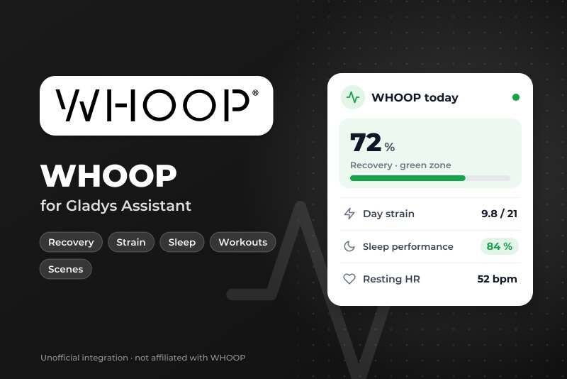
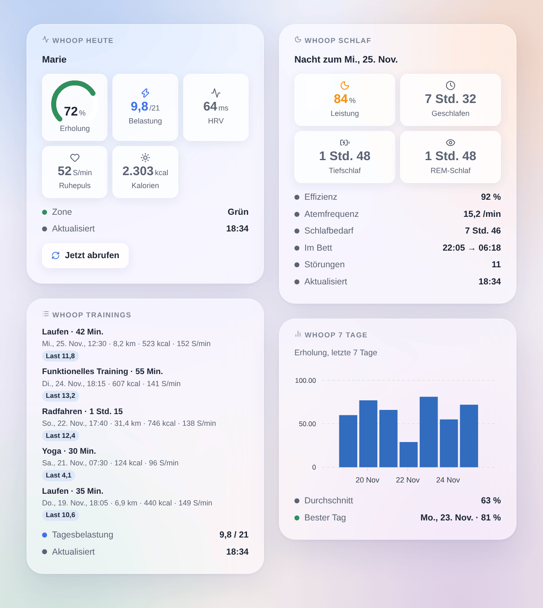
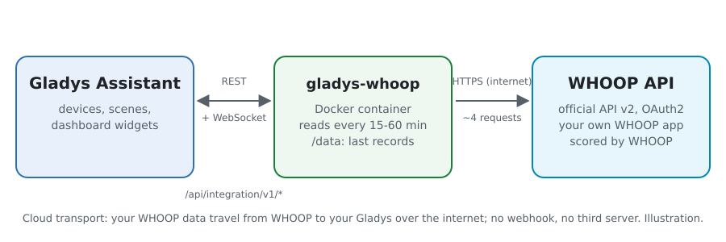
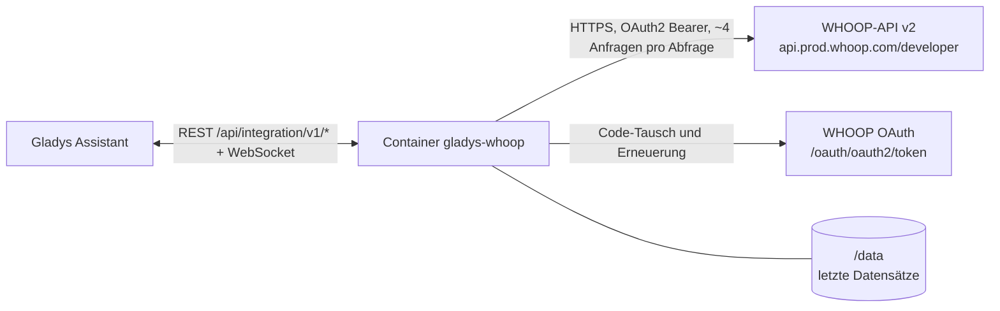
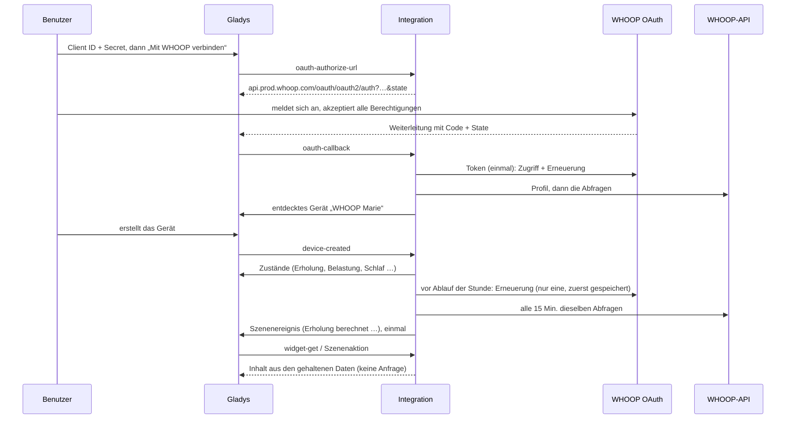

# Gladys WHOOP

[English](README.md) · [Français](README.fr.md) · **Deutsch** · [Español](README.es.md)

[](LICENSE)
[](https://github.com/William-De71/gladys-whoop/releases)
[](https://github.com/William-De71/gladys-whoop/actions/workflows/release.yml)
[](https://gladysassistant.com)



Externe Integration für [Gladys Assistant](https://gladysassistant.com) für **WHOOP**, über die offizielle API der [WHOOP Developer Platform](https://developer.whoop.com) und deine eigene WHOOP-App. Erholung, Belastung, Schlaf und Trainings werden zu einem Gerät, Dashboard-Widgets und Szenenauslösern: „Wenn meine Erholung berechnet ist, öffne die Rollläden und sag mir, wie ich geschlafen habe“.

Benutzerdokumentation: [English](docs/en.md) · [Français](docs/fr.md) · [Deutsch](docs/de.md) · [Español](docs/es.md).

> Community-Integration, nicht mit WHOOP, Inc. verbunden, nicht von WHOOP unterstützt oder gesponsert. WHOOP ist eine Marke der WHOOP, Inc. Bisher nie mit einem echten WHOOP-Konto getestet: Jede Antwortform stammt aus der offiziellen API-Referenz.

## Funktionen

- **Ein Gerät pro verknüpftem Mitglied**: Erholung und ihre Zone, Ruhepuls, HRV, Blutsauerstoff, Hauttemperatur; heutige Belastung und Kalorien; Schlafleistung, Schlafdauer, Effizienz und Atemfrequenz; Belastung des letzten Trainings.
- **Vier Widgets**: heute (mit einer Abruf-Schaltfläche), letzter Schlaf, Trainings, letzte sieben Tage.
- **Drei Szenenauslöser** und **eine Szenenaktion** (siehe unten).
- **OAuth 2.0 mit deiner eigenen WHOOP-App**: Das Zugriffstoken (etwa eine Stunde) erneuert sich selbst; das Refresh-Token rotiert, deshalb wird es immer nur einmal gleichzeitig erneuert und vor der Verwendung gespeichert.
- **Cloud**, alle 15 bis 60 Minuten abgefragt (etwa vier Anfragen), weit unter den Limits (100 pro Minute, 10.000 pro Tag und App), Daten in `/data` gehalten.
- Englisch, Französisch, Deutsch und Spanisch überall.



## Funktionsweise





Der Benutzer erstellt auf developer-dashboard.whoop.com eine App mit der Redirect-URL von Gladys und allen Lese-Berechtigungen. „Mit WHOOP verbinden“ öffnet die Anmeldung von WHOOP mit den Berechtigungen, `offline` (für ein Refresh-Token) und einem 8-stelligen `state` (wie die Doku verlangt); Gladys reicht den Code weiter, die Integration tauscht ihn genau einmal ein (Zugangsdaten im Formularkörper) und liest dann das Profil für die Mitglieds-ID. Das Zugriffstoken gilt etwa eine Stunde; vor seinem Ablauf (oder nach einem 401) wird das Refresh-Token gegen ein neues Paar getauscht. WHOOP rotiert Refresh-Tokens und lehnt die zweite von zwei gleichzeitigen Erneuerungen ab: Es läuft immer nur eine Erneuerung, und das neue Paar wird in die Konfiguration geschrieben, bevor eine Anfrage es verwendet. Jede Abfrage liest Zyklen, Erholungen, Schlafphasen und Trainings (neueste zuerst) und zweimal täglich die Körpermaße. Die Webhooks von WHOOP werden nicht genutzt: Sie brauchen eine öffentliche HTTPS-URL und signierte Anfragen, deren Header Gladys Plus nicht weitergibt.



### Transport

Nur Cloud (`"transports": ["cloud"]`): Der Katalog zeigt das Cloud-Abzeichen. Deine WHOOP-Daten gehen über das Internet von den Servern von WHOOP zu deinem Gladys, mit deiner eigenen App; nichts läuft über einen Drittserver. Es gibt keine lokale Alternative, daher auch keine Schaltfläche „lokale Verbindung bevorzugen“.

## Geräte und Funktionen

| Funktion                        | Kategorie / Typ                  | Einheit       |
| ------------------------------- | -------------------------------- | ------------- |
| Erholung                        | `level-sensor` / `decimal`       | %             |
| Erholungszone                   | `text` / `text`                  | —             |
| Ruhepuls (S/min)                | `counter-sensor` / `integer`     | —             |
| Herzfrequenzvariabilität (HRV)  | `duration` / `decimal`           | Millisekunden |
| Blutsauerstoff (SpO2)           | `level-sensor` / `decimal`       | %             |
| Hauttemperatur                  | `temperature-sensor` / `decimal` | °C            |
| Tagesbelastung (0-21)           | `level-sensor` / `decimal`       | —             |
| Kalorien heute (kcal)           | `counter-sensor` / `integer`     | —             |
| Schlafleistung                  | `level-sensor` / `decimal`       | %             |
| Schlafdauer                     | `duration` / `decimal`           | Stunden       |
| Schlafeffizienz                 | `level-sensor` / `decimal`       | %             |
| Atemfrequenz (/min)             | `level-sensor` / `decimal`       | —             |
| Belastung des letzten Trainings | `level-sensor` / `decimal`       | —             |

Gladys hat keine Gesundheitskategorie und keine Einheit für Puls, Kalorien oder Gewicht: Zählwerte nutzen `counter-sensor` ohne Einheit (die Einheit steht im Namen), und das Gewicht ist nur eine Ausgabe der Szenenaktion. Die Geräte-ID stammt von der WHOOP-Mitglieds-ID, nie von einem Namen. Ein Wert wird erst veröffentlicht, wenn WHOOP ihn berechnet hat.

## Szenenauslöser, Aktionen und Widgets

| Art      | Schlüssel         | Verwendung                                                                |
| -------- | ----------------- | ------------------------------------------------------------------------- |
| Auslöser | `recovery_scored` | die Morgen-Erholung mit HRV, Ruhepuls, SpO2 (Filter: Zone)                |
| Auslöser | `sleep_scored`    | ein Schlaf oder Nickerchen mit seinen Phasen (Filter: Art)                |
| Auslöser | `workout_scored`  | ein neues Training mit seiner Belastung (Filter: Sportgruppe)             |
| Aktion   | `get_summary`     | die letzten Werte (19 Ausgaben, inklusive Gewicht), ohne Anfrage          |
| Widget   | `today`           | Erholungsanzeige in der Farbe ihrer Zone, Belastung, HRV, Ruhepuls, Abruf |
| Widget   | `sleep`           | Leistung, Schlafdauer, Tief- und REM-Schlaf, Schlafbedarf                 |
| Widget   | `workouts`        | die letzten Trainings mit ihrer Belastung, heutige Belastung              |
| Widget   | `week`            | Erholung, Belastung, Schlafleistung oder HRV der letzten 7 Tage           |

Beispiele: **Erholung berechnet** → die Zusammenfassung ans Handy senden und die Rollläden öffnen; **Erholung berechnet** in der roten Zone → sanfteres Morgenlicht; **Training berechnet** (Laufen) → den Handtuchheizkörper einschalten.

## Voraussetzungen

- Gladys Assistant **5.3.0** oder neuer (Katalog-Schlüsselwörter von Gladys 5.3, Widgets und Szenen externer Integrationen). Ältere Instanzen können die Integration nicht installieren.
- Eine aktive WHOOP-Mitgliedschaft.
- Eine kostenlose WHOOP-App auf [developer-dashboard.whoop.com](https://developer-dashboard.whoop.com) mit allen Lese-Berechtigungen und `https://my.gladysassistant.com/redirect/oauth` als Redirect-URL. Die Sandbox-Stufe einer App erlaubt bis zu 10 Mitglieder.

## Installation

- **Aus dem Store** von Gladys (Integrationen → Externe Integrationen), mit einem Klick, sobald indexiert.
- **Über die URL des Repositorys**: `https://github.com/William-De71/gladys-whoop`.
- **Entwicklermodus**: das Image lokal bauen (`docker build -t gladys-whoop .`) und aus Gladys installieren.

## Konfiguration

| Feld                | Beschreibung                                                                                       |
| ------------------- | -------------------------------------------------------------------------------------------------- |
| Client ID           | Die Client ID deiner WHOOP-App.                                                                    |
| Client Secret       | Ihr Secret (ein geheimes Feld, nie protokolliert).                                                 |
| Mit WHOOP verbinden | Verknüpft das Konto (Lese-Berechtigungen und `offline`, nur Lesen).                                |
| Abfrageintervall    | 15 (Standard), 30 oder 60 Minuten.                                                                 |
| Sprache der Texte   | Gerätenamen, Erholungszone, Sportarten und Szenen-Zusammenfassungen (automatisch: dein Dashboard). |

Schaltflächen: **Jetzt abrufen**, **WHOOP-Konto trennen** (`DELETE /v2/user/access`, die Tokens werden vergessen) und **Diagnose** (schreibt einen anonymisierten Zustand in den Reiter Protokolle).

## Verwendung

1. Die WHOOP-App erstellen, Client ID und Secret einfügen, speichern, **Mit WHOOP verbinden** klicken.
2. Im Reiter **Entdecken** das Gerät „WHOOP …“ erstellen.
3. Die Widgets zu einem Dashboard hinzufügen und Szenen mit den Auslösern bauen.

## Entwicklung

```bash
npm install
npm test                       # node --test, nie das Netz
npm run lint && npm run format:check
npx github:GladysAssistant/integration-store . --skip-image-check
scripts/build-cover.sh         # cover.jpg aus docs/assets/cover.svg
docs/illustrations/render.sh   # docs/assets/widgets.<Sprache>.png
node .github/scripts/release.mjs next
```

Lokal liest das SDK `GLADYS_HOST_API_URL`, `GLADYS_INTEGRATION_TOKEN` und `GLADYS_INTEGRATION_SELECTOR`; `TZ` legt „heute“ fest. `DEBUG=gladys-integration-sdk` zeigt die Protokolle des SDK und prüft jeden Widget-Inhalt. Die Tests nutzen ein nachgebildetes WHOOP (inklusive rotierender Refresh-Tokens) und erfundene Antworten im Format der API-Referenz (`test/helpers/`). Die Regeln des Projekts stehen in [CLAUDE.md](CLAUDE.md).

## Release-Prozess


Jeder Merge auf `main` startet die CI und berechnet dann die Version aus den [Conventional Commits](https://www.conventionalcommits.org/) seit dem letzten Tag: `feat` → Minor, `fix` / `perf` → Patch, `!` oder `BREAKING CHANGE` → Major (Minor unter 1.0.0). `docs`, `chore`, `ci`, `test`, `style`, `refactor` und `build` allein veröffentlichen nichts. Der Workflow erzeugt den Changelog-Abschnitt, pusht den Tag und baut das Multi-Architektur-Image. Erst danach erhält `main` den Release-Commit und das GitHub Release wird erstellt. Ein letzter Job prüft das öffentliche Image, den Store-Validator und das Topic.

- Der Titel des Pull Requests wird zum Squash-Commit und dann zur Changelog-Zeile: auf Englisch, für den Nutzer (`pr-title.yml` prüft ihn). `CHANGELOG.md` nie von Hand bearbeiten.
- 1.0.0 ist eine Entscheidung: Actions → Release → Run workflow mit `release-as: 1.0.0`. `dry-run` zeigt Version und Notizen, ohne zu veröffentlichen.
- **Geschützter Branch**: Rulesets verlangen einen Pull Request auf `main` und sperren die `v*`-Tags; nur der Maintainer und Deploy Keys kommen durch. Das Release pusht mit dem Deploy Key der Umgebung `release` (Secret `RELEASE_DEPLOY_KEY`, nur `main`): Ein Lauf von einem anderen Branch erhält ihn nie. `build.yml` und `github-release.yml` starten nicht bei einem Tag: Das Release ruft sie auf, oder starten Sie sie von Hand (Actions → Run workflow, mit `version` für das Image), um ein Release abzuschließen.
- Nach dem ersten Release das Paket auf `ghcr.io` öffentlich machen (Package settings → Change visibility), sonst kann Gladys es nicht laden.

## Fehlerbehebung

Siehe [docs/de.md](docs/de.md#fehlerbehebung). Melde Probleme mit den Versionen von Gladys und der Integration, dem Armbandmodell und den Zeilen der Schaltfläche **Diagnose**.

## Mitwirken

Issues und Pull Requests sind willkommen. Führe vor einem Pull Request `npm run format:check && npm run lint && npm test` aus und lass jede externe ID und jeden gespeicherten Schlüssel unverändert (siehe [CLAUDE.md](CLAUDE.md)). Eine echte Antwort der WHOOP-API, die von der Referenz abweicht, ist als neuer Testfall sehr willkommen (vorher Namen, E-Mail-Adressen und IDs entfernen).

## Sicherheit

Siehe [SECURITY.md](SECURITY.md): Sicherheitslücken bitte vertraulich melden. Das Client Secret ist ein geheimes Feld; Tokens und OAuth-State sind interne Konfigurationsschlüssel, nie in `/data` oder in die Protokolle geschrieben. Ein Autorisierungscode und ein Refresh-Token werden nie zweimal an WHOOP gesendet.

## Kommende Screenshots

Die Bilder oben sind Illustrationen, keine Screenshots. Echte Screenshots kommen nach `docs/assets/screenshots/` (PNG, 1280 × 800): `configuration.png`, `discovery.png`, `device.png`, `scene.png`.

## Lizenz

[Apache License 2.0](LICENSE) — siehe auch [NOTICE](NOTICE). Die Daten stammen aus deiner WHOOP-Mitgliedschaft über die API der WHOOP Developer Platform, gemäß den API-Bedingungen von WHOOP. Danke an die Dokumentation und das SDK von Gladys.
