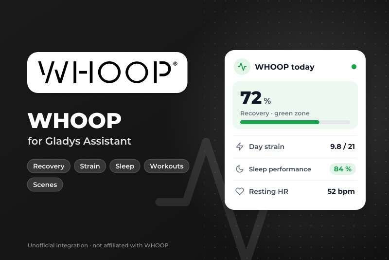
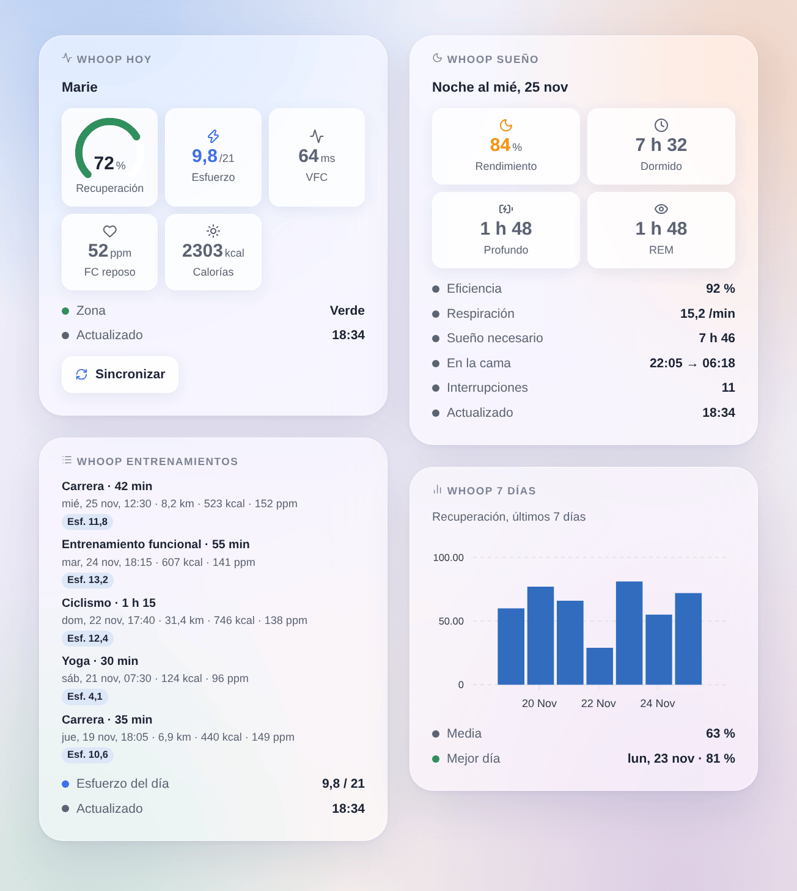
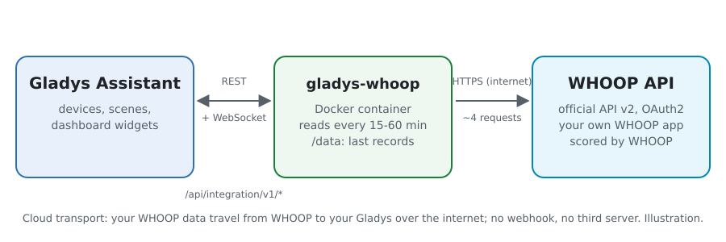
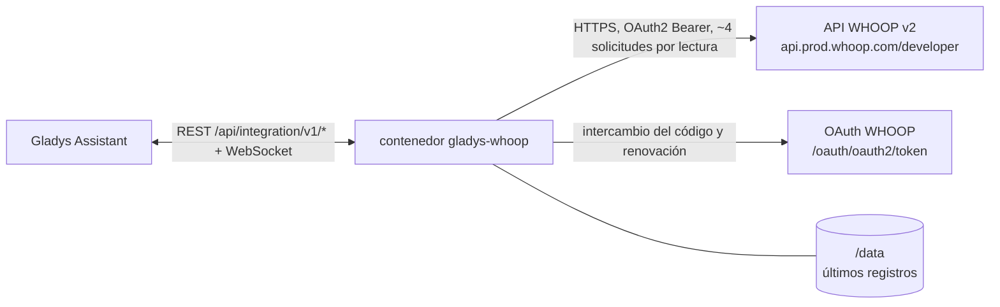
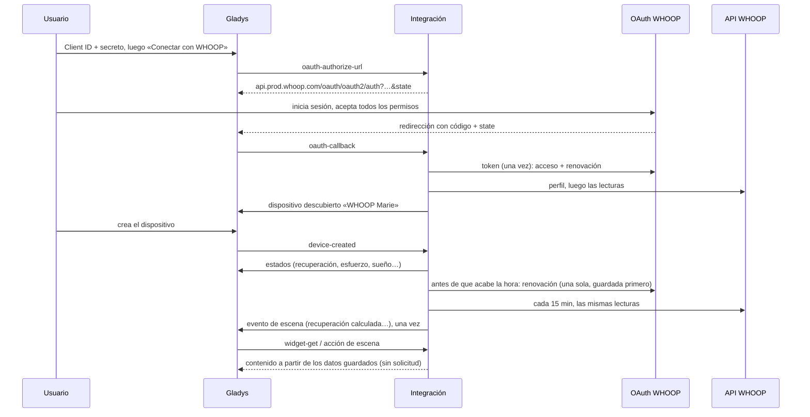

# Gladys WHOOP

[English](README.md) · [Français](README.fr.md) · [Deutsch](README.de.md) · **Español**

[](LICENSE)
[](https://github.com/William-De71/gladys-whoop/releases)
[](https://github.com/William-De71/gladys-whoop/actions/workflows/release.yml)
[](https://gladysassistant.com)



Integración externa de [Gladys Assistant](https://gladysassistant.com) para **WHOOP**, mediante la API oficial de la [WHOOP Developer Platform](https://developer.whoop.com) y su propia aplicación WHOOP. Recuperación, esfuerzo, sueño y entrenamientos se convierten en un dispositivo, widgets del panel y disparadores de escena: «cuando se calcule mi recuperación, abre las persianas y dime cómo he dormido».

Documentación de usuario: [English](docs/en.md) · [Français](docs/fr.md) · [Deutsch](docs/de.md) · [Español](docs/es.md).

> Integración comunitaria, no afiliada, respaldada ni patrocinada por WHOOP, Inc. WHOOP es una marca de WHOOP, Inc. Nunca probada con una cuenta WHOOP real hasta ahora: cada forma de respuesta viene de la referencia oficial de la API.

## Funciones

- **Un dispositivo por miembro vinculado**: recuperación y su zona, frecuencia cardíaca en reposo, VFC, oxígeno en sangre, temperatura de la piel; esfuerzo y calorías del día; rendimiento, duración, eficiencia del sueño y frecuencia respiratoria; esfuerzo del último entrenamiento.
- **Cuatro widgets**: hoy (con un botón de sincronización), último sueño, entrenamientos, últimos siete días.
- **Tres disparadores de escena** y **una acción de escena** (ver abajo).
- **OAuth 2.0 con su propia aplicación WHOOP**: el token de acceso (una hora aproximadamente) se renueva solo; el token de renovación cambia cada vez, así que se renueva de uno en uno y se guarda antes de usarlo.
- **Nube**, leída cada 15 a 60 minutos (unas cuatro solicitudes), muy por debajo de los límites (100 por minuto, 10 000 al día por aplicación), datos guardados en `/data`.
- Inglés, francés, alemán y español en todas partes.



## Funcionamiento





El usuario crea una aplicación en developer-dashboard.whoop.com con la URL de redirección de Gladys y todos los permisos de lectura. «Conectar con WHOOP» abre el inicio de sesión de WHOOP con los permisos, `offline` (para un token de renovación) y un `state` de 8 caracteres (como pide la documentación); Gladys reenvía el código, que la integración intercambia una sola vez (credenciales en el cuerpo del formulario), y luego lee el perfil para el identificador del miembro. El token de acceso dura una hora aproximadamente; antes de que caduque (o tras un 401) el token de renovación se cambia por un nuevo par. WHOOP rota los tokens de renovación y rechaza el segundo de dos renovaciones simultáneas: solo hay una renovación a la vez, y el nuevo par se escribe en la configuración antes de que una solicitud lo use. Cada lectura pide los ciclos, recuperaciones, sueños y entrenamientos (los más recientes primero), y las medidas corporales dos veces al día. Los webhooks de WHOOP no se usan: exigen una URL HTTPS pública y solicitudes firmadas cuya cabecera Gladys Plus no transmite.



### Transporte

Solo nube (`"transports": ["cloud"]`): el catálogo muestra la insignia de nube. Sus datos de WHOOP van de los servidores de WHOOP a su Gladys por Internet, con su propia aplicación; nada pasa por un servidor de terceros. No hay alternativa local, así que no hay botón «preferir la conexión local».

## Dispositivos y funciones

| Función                             | Categoría / tipo                 | Unidad       |
| ----------------------------------- | -------------------------------- | ------------ |
| Recuperación                        | `level-sensor` / `decimal`       | %            |
| Zona de recuperación                | `text` / `text`                  | —            |
| Frecuencia cardíaca en reposo (ppm) | `counter-sensor` / `integer`     | —            |
| Variabilidad cardíaca (VFC)         | `duration` / `decimal`           | milisegundos |
| Oxígeno en sangre (SpO2)            | `level-sensor` / `decimal`       | %            |
| Temperatura de la piel              | `temperature-sensor` / `decimal` | °C           |
| Esfuerzo del día (0-21)             | `level-sensor` / `decimal`       | —            |
| Calorías de hoy (kcal)              | `counter-sensor` / `integer`     | —            |
| Rendimiento del sueño               | `level-sensor` / `decimal`       | %            |
| Tiempo dormido                      | `duration` / `decimal`           | horas        |
| Eficiencia del sueño                | `level-sensor` / `decimal`       | %            |
| Frecuencia respiratoria (/min)      | `level-sensor` / `decimal`       | —            |
| Esfuerzo del último entrenamiento   | `level-sensor` / `decimal`       | —            |

Gladys no tiene categoría de salud ni unidad de frecuencia cardíaca, calorías o peso: los recuentos usan `counter-sensor` sin unidad (la unidad está en el nombre), y el peso solo es una salida de la acción de escena. El identificador del dispositivo viene del identificador WHOOP del miembro, nunca de un nombre. Un valor solo se publica cuando WHOOP lo ha calculado.

## Disparadores, acciones y widgets

| Tipo       | Clave             | Uso                                                                                      |
| ---------- | ----------------- | ---------------------------------------------------------------------------------------- |
| Disparador | `recovery_scored` | la recuperación de la mañana, con VFC, FC en reposo, SpO2 (filtro: zona)                 |
| Disparador | `sleep_scored`    | un sueño o una siesta, con sus fases (filtro: tipo)                                      |
| Disparador | `workout_scored`  | un nuevo entrenamiento, con su esfuerzo (filtro: familia de deporte)                     |
| Acción     | `get_summary`     | los últimos valores (19 salidas, peso incluido), sin solicitud                           |
| Widget     | `today`           | indicador de recuperación del color de su zona, esfuerzo, VFC, FC en reposo, sincronizar |
| Widget     | `sleep`           | rendimiento, duración, sueño profundo y REM, sueño necesario                             |
| Widget     | `workouts`        | los últimos entrenamientos con su esfuerzo, esfuerzo del día                             |
| Widget     | `week`            | recuperación, esfuerzo, sueño o VFC de los últimos 7 días                                |

Ejemplos: **recuperación calculada** → enviar el resumen a su teléfono y abrir las persianas; **recuperación calculada** en zona roja → luces de la mañana más suaves; **entrenamiento calculado** (carrera) → encender el toallero.

## Requisitos

- Gladys Assistant **5.3.0** o posterior (palabras clave del catálogo de Gladys 5.3, widgets y escenas de las integraciones externas). Las instancias más antiguas no pueden instalar la integración.
- Una suscripción WHOOP activa.
- Una aplicación WHOOP gratuita creada en [developer-dashboard.whoop.com](https://developer-dashboard.whoop.com), con todos los permisos de lectura y `https://my.gladysassistant.com/redirect/oauth` como URL de redirección. El nivel Sandbox de una aplicación admite hasta 10 miembros.

## Instalación

- **Desde la tienda** de Gladys (Integraciones → Integraciones externas), con un clic, una vez indexada.
- **Desde la URL del repositorio**: `https://github.com/William-De71/gladys-whoop`.
- **Modo desarrollador**: construya la imagen en local (`docker build -t gladys-whoop .`) e instálela desde Gladys.

## Configuración

| Campo                | Descripción                                                                                                |
| -------------------- | ---------------------------------------------------------------------------------------------------------- |
| Client ID            | El Client ID de su aplicación WHOOP.                                                                       |
| Client Secret        | Su secreto (un campo secreto, nunca registrado).                                                           |
| Conectar con WHOOP   | Vincula la cuenta (permisos de lectura y `offline`, solo lectura).                                         |
| Intervalo de lectura | 15 (por defecto), 30 o 60 minutos.                                                                         |
| Idioma de los textos | Nombres de los dispositivos, zona de recuperación, deportes y resúmenes de escenas (automático: su panel). |

Botones: **Sincronizar ahora**, **Desvincular la cuenta WHOOP** (`DELETE /v2/user/access`, los tokens se olvidan) y **Diagnóstico** (escribe un estado anonimizado en la pestaña Registros).

## Uso

1. Cree la aplicación WHOOP, pegue su Client ID y su secreto, guarde y pulse **Conectar con WHOOP**.
2. En la pestaña **Descubrir**, cree el dispositivo «WHOOP …».
3. Añada los widgets a un panel y construya escenas con los disparadores.

## Desarrollo

```bash
npm install
npm test                       # node --test, nunca toca la red
npm run lint && npm run format:check
npx github:GladysAssistant/integration-store . --skip-image-check
scripts/build-cover.sh         # cover.jpg a partir de docs/assets/cover.svg
docs/illustrations/render.sh   # docs/assets/widgets.<idioma>.png
node .github/scripts/release.mjs next
```

En local, el SDK lee `GLADYS_HOST_API_URL`, `GLADYS_INTEGRATION_TOKEN` y `GLADYS_INTEGRATION_SELECTOR`; `TZ` fija «hoy». `DEBUG=gladys-integration-sdk` muestra los registros del SDK y comprueba cada contenido de widget. Las pruebas usan un WHOOP simulado (con tokens de renovación rotativos) y respuestas inventadas con el formato de la referencia de la API (`test/helpers/`). Las reglas del proyecto están en [CLAUDE.md](CLAUDE.md).

## Proceso de publicación


Cada fusión en `main` lanza la CI y calcula la versión a partir de los [Conventional Commits](https://www.conventionalcommits.org/) desde la última etiqueta: `feat` → menor, `fix` / `perf` → parche, `!` o `BREAKING CHANGE` → mayor (menor por debajo de 1.0.0). `docs`, `chore`, `ci`, `test`, `style`, `refactor` y `build` solos no publican nada. El workflow genera la sección del changelog, sube la etiqueta y construye la imagen multiarquitectura. Solo después `main` recibe el commit de publicación y se crea la GitHub Release. Un último job comprueba la imagen pública, el validador de la tienda y el topic.

- El título de la pull request se convierte en el commit squash y luego en la línea del changelog: escríbelo en inglés, para el usuario (`pr-title.yml` lo comprueba). Nunca edites `CHANGELOG.md` a mano.
- 1.0.0 es una decisión: Actions → Release → Run workflow con `release-as: 1.0.0`. `dry-run` muestra la versión y las notas sin publicar.
- **Rama protegida**: unos rulesets exigen una pull request en `main` y bloquean las etiquetas `v*`; solo pasan el mantenedor y las deploy keys. La publicación hace push con la deploy key del entorno `release` (secreto `RELEASE_DEPLOY_KEY`, solo `main`): una ejecución lanzada desde otra rama nunca la obtiene. `build.yml` y `github-release.yml` no arrancan con una etiqueta: la publicación los llama, o lánzelos a mano (Actions → Run workflow, con `version` para la imagen) para terminar una publicación.
- Tras la primera publicación, haz público el paquete de `ghcr.io` (Package settings → Change visibility), o Gladys no podrá descargarlo.

## Solución de problemas

Vea [docs/es.md](docs/es.md#solución-de-problemas). Informe de los problemas con las versiones de Gladys y de la integración, el modelo de pulsera y las líneas del botón **Diagnóstico**.

## Contribuir

Las issues y pull requests son bienvenidas. Ejecute `npm run format:check && npm run lint && npm test` antes de abrir una pull request y mantenga sin cambios cada identificador externo y cada clave guardada (vea [CLAUDE.md](CLAUDE.md)). Una respuesta real de la API de WHOOP distinta de la referencia es muy bienvenida como nuevo caso de prueba (quite antes nombres, direcciones de correo e identificadores).

## Seguridad

Vea [SECURITY.md](SECURITY.md): informe de las vulnerabilidades en privado. El client secret es un campo secreto; los tokens y el estado OAuth son claves internas de configuración, nunca escritas en `/data` ni en los registros. Un código de autorización y un token de renovación nunca se envían dos veces a WHOOP.

## Capturas pendientes

Las imágenes de arriba son ilustraciones, no capturas. Las capturas reales irán en `docs/assets/screenshots/` (PNG, 1280 × 800): `configuration.png`, `discovery.png`, `device.png`, `scene.png`.

## Licencia

[Licencia Apache 2.0](LICENSE) — vea también [NOTICE](NOTICE). Los datos vienen de su suscripción WHOOP mediante la API de la WHOOP Developer Platform, según las condiciones de la API de WHOOP. Gracias a la documentación y al SDK de Gladys.
