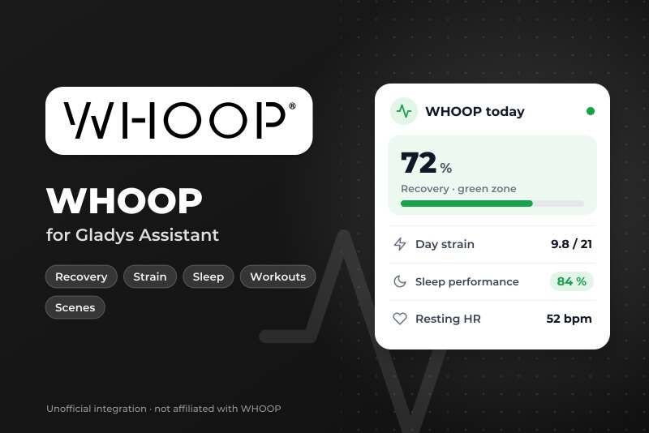
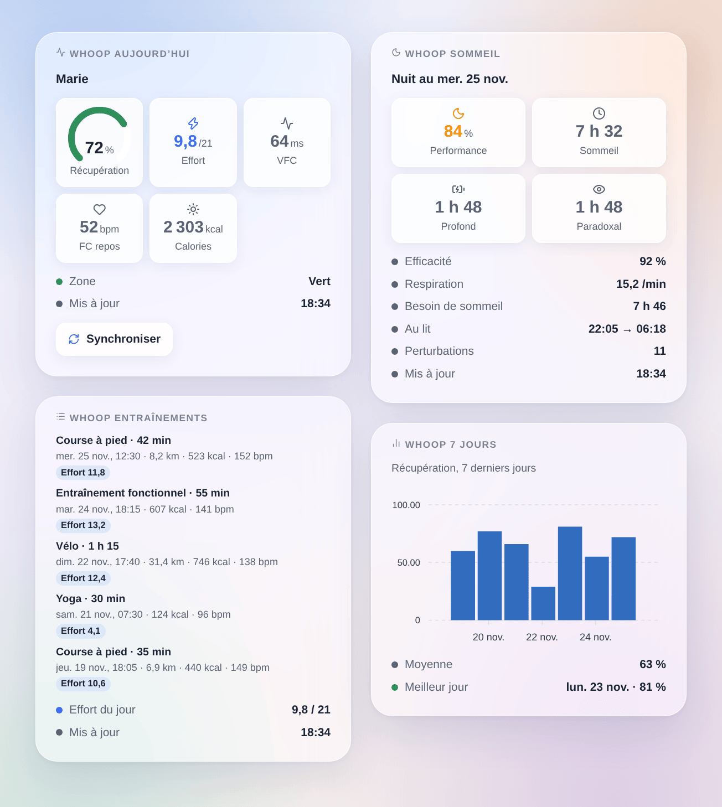
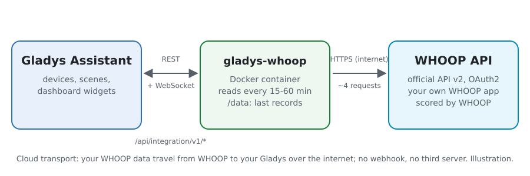
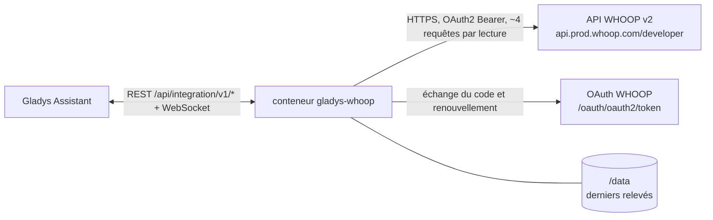
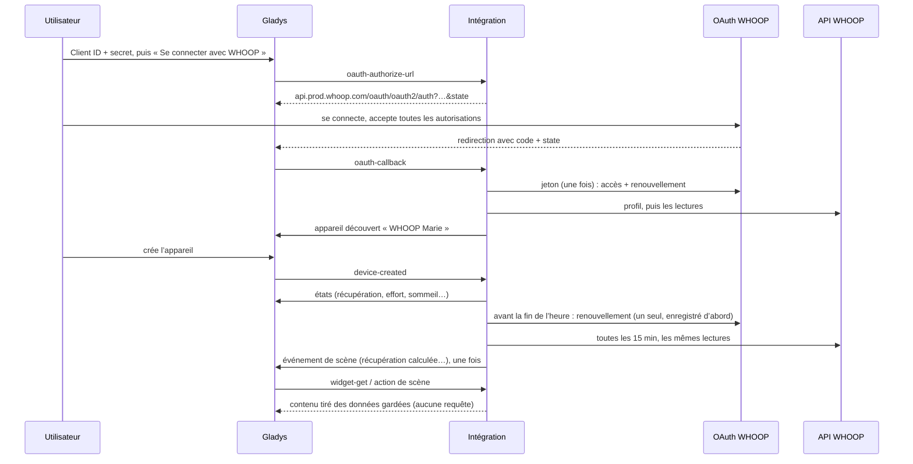

# Gladys WHOOP

[English](README.md) · **Français** · [Deutsch](README.de.md) · [Español](README.es.md)

[](LICENSE)
[](https://github.com/William-De71/gladys-whoop/releases)
[](https://github.com/William-De71/gladys-whoop/actions/workflows/release.yml)
[](https://gladysassistant.com)



Intégration externe de [Gladys Assistant](https://gladysassistant.com) pour **WHOOP**, par l’API officielle [WHOOP Developer Platform](https://developer.whoop.com) et votre propre application WHOOP. Récupération, effort, sommeil et entraînements deviennent un appareil, des widgets de tableau de bord et des déclencheurs de scène : « quand ma récupération est calculée, ouvre les volets et dis-moi comment j’ai dormi ».

Documentation utilisateur : [English](docs/en.md) · [Français](docs/fr.md) · [Deutsch](docs/de.md) · [Español](docs/es.md).

> Intégration communautaire, sans lien avec WHOOP, Inc., ni approuvée ni parrainée par elle. WHOOP est une marque de WHOOP, Inc. Jamais testée avec un vrai compte WHOOP à ce jour : chaque forme de réponse vient de la référence officielle de l’API.

## Fonctionnalités

- **Un appareil par membre lié** : récupération et sa zone, fréquence cardiaque au repos, VFC, oxygène sanguin, température cutanée ; effort et calories du jour ; performance, durée, efficacité du sommeil et fréquence respiratoire ; effort du dernier entraînement.
- **Quatre widgets** : aujourd’hui (avec un bouton de synchronisation), dernier sommeil, entraînements, sept derniers jours.
- **Trois déclencheurs de scène** et **une action de scène** (voir plus bas).
- **OAuth 2.0 avec votre propre application WHOOP** : le jeton d’accès (environ une heure) se renouvelle seul ; le jeton de renouvellement change à chaque fois, il est donc renouvelé un seul à la fois et enregistré avant d’être utilisé.
- **Cloud**, lu toutes les 15 à 60 minutes (environ quatre requêtes), très loin des limites (100 par minute, 10 000 par jour et par application), données gardées dans `/data`.
- Anglais, français, allemand et espagnol partout.



## Fonctionnement





L’utilisateur crée une application sur developer-dashboard.whoop.com avec l’URL de redirection de Gladys et toutes les autorisations de lecture. « Se connecter avec WHOOP » ouvre la connexion WHOOP avec les autorisations, `offline` (pour un jeton de renouvellement) et un `state` de 8 caractères (comme le demande la doc) ; Gladys relaie le code, que l’intégration échange une seule fois (identifiants dans le corps du formulaire), puis lit le profil pour l’identifiant du membre. Le jeton d’accès dure environ une heure ; avant sa fin (ou après un 401), le jeton de renouvellement est échangé contre une nouvelle paire. WHOOP fait tourner les jetons de renouvellement et refuse le second de deux renouvellements simultanés : un seul renouvellement à la fois, et la nouvelle paire est écrite dans la configuration avant qu’une requête ne s’en serve. Chaque lecture demande les cycles, récupérations, sommeils et entraînements (les plus récents d’abord), et les mensurations deux fois par jour. Les webhooks de WHOOP ne sont pas utilisés : ils exigent une URL HTTPS publique et des requêtes signées dont Gladys Plus ne transmet pas l’en-tête.



### Transport

Cloud uniquement (`"transports": ["cloud"]`) : le catalogue affiche le badge cloud. Vos données WHOOP vont des serveurs de WHOOP à votre Gladys par Internet, avec votre propre application ; rien ne passe par un serveur tiers. Il n’y a pas d’alternative locale, donc pas de bouton « préférer la connexion locale ».

## Appareils et fonctionnalités

| Fonctionnalité                 | Catégorie / type                 | Unité         |
| ------------------------------ | -------------------------------- | ------------- |
| Récupération                   | `level-sensor` / `decimal`       | %             |
| Zone de récupération           | `text` / `text`                  | —             |
| Fréquence cardiaque au repos   | `counter-sensor` / `integer`     | —             |
| Variabilité cardiaque (VFC)    | `duration` / `decimal`           | millisecondes |
| Oxygène sanguin (SpO2)         | `level-sensor` / `decimal`       | %             |
| Température cutanée            | `temperature-sensor` / `decimal` | °C            |
| Effort du jour (0-21)          | `level-sensor` / `decimal`       | —             |
| Calories du jour (kcal)        | `counter-sensor` / `integer`     | —             |
| Performance du sommeil         | `level-sensor` / `decimal`       | %             |
| Temps de sommeil               | `duration` / `decimal`           | heures        |
| Efficacité du sommeil          | `level-sensor` / `decimal`       | %             |
| Fréquence respiratoire (/min)  | `level-sensor` / `decimal`       | —             |
| Effort du dernier entraînement | `level-sensor` / `decimal`       | —             |

Gladys n’a ni catégorie santé ni unité de fréquence cardiaque, de calories ou de poids : les comptes utilisent `counter-sensor` sans unité (l’unité est dans le nom), et le poids n’est qu’une sortie de l’action de scène. L’identifiant de l’appareil vient de l’identifiant WHOOP du membre, jamais d’un nom. Une valeur n’est publiée qu’une fois calculée par WHOOP.

## Déclencheurs, actions et widgets

| Type        | Clé               | Usage                                                                            |
| ----------- | ----------------- | -------------------------------------------------------------------------------- |
| Déclencheur | `recovery_scored` | la récupération du matin, avec VFC, FC au repos, SpO2 (filtre : zone)            |
| Déclencheur | `sleep_scored`    | un sommeil ou une sieste, avec ses phases (filtre : type)                        |
| Déclencheur | `workout_scored`  | un nouvel entraînement, avec son effort (filtre : famille de sport)              |
| Action      | `get_summary`     | les dernières valeurs (19 sorties, poids compris), sans requête                  |
| Widget      | `today`           | jauge de récupération à la couleur de sa zone, effort, VFC, FC au repos, synchro |
| Widget      | `sleep`           | performance, durée, sommeil profond et paradoxal, besoin de sommeil              |
| Widget      | `workouts`        | les derniers entraînements avec leur effort, l’effort du jour                    |
| Widget      | `week`            | récupération, effort, sommeil ou VFC des 7 derniers jours                        |

Exemples : **récupération calculée** → envoyer le résumé sur votre téléphone et ouvrir les volets ; **récupération calculée** en zone rouge → lumières du matin plus douces ; **entraînement calculé** (course) → allumer le sèche-serviettes.

## Prérequis

- Gladys Assistant **5.3.0** ou plus récent (mots-clés du catalogue de Gladys 5.3, widgets et scènes des intégrations externes). Les instances plus anciennes ne peuvent pas installer l’intégration.
- Un abonnement WHOOP actif.
- Une application WHOOP gratuite créée sur [developer-dashboard.whoop.com](https://developer-dashboard.whoop.com), avec toutes les autorisations de lecture et `https://my.gladysassistant.com/redirect/oauth` comme URL de redirection. Le palier Sandbox d’une application accepte jusqu’à 10 membres.

## Installation

- **Depuis le store** de Gladys (Intégrations → Intégrations externes), en un clic, une fois indexée.
- **Depuis l’URL du dépôt** : `https://github.com/William-De71/gladys-whoop`.
- **Mode développeur** : construisez l’image en local (`docker build -t gladys-whoop .`) et installez-la depuis Gladys.

## Configuration

| Champ                   | Description                                                                                                   |
| ----------------------- | ------------------------------------------------------------------------------------------------------------- |
| Client ID               | Le Client ID de votre application WHOOP.                                                                      |
| Client Secret           | Son secret (un champ secret, jamais journalisé).                                                              |
| Se connecter avec WHOOP | Lie le compte (autorisations de lecture et `offline`, lecture seule).                                         |
| Fréquence de lecture    | 15 (par défaut), 30 ou 60 minutes.                                                                            |
| Langue des textes       | Noms des appareils, zone de récupération, sports et résumés des scènes (automatique : votre tableau de bord). |

Boutons : **Synchroniser maintenant**, **Délier le compte WHOOP** (`DELETE /v2/user/access`, les jetons sont oubliés) et **Diagnostic** (écrit un état anonymisé dans l’onglet Journaux).

## Utilisation

1. Créez l’application WHOOP, collez son Client ID et son secret, enregistrez, cliquez sur **Se connecter avec WHOOP**.
2. Dans l’onglet **Découverte**, créez l’appareil « WHOOP … ».
3. Ajoutez les widgets à un tableau de bord et construisez des scènes sur les déclencheurs.

## Développement

```bash
npm install
npm test                       # node --test, ne touche jamais le réseau
npm run lint && npm run format:check
npx github:GladysAssistant/integration-store . --skip-image-check
scripts/build-cover.sh         # cover.jpg depuis docs/assets/cover.svg
docs/illustrations/render.sh   # docs/assets/widgets.<langue>.png
node .github/scripts/release.mjs next
```

En local, le SDK lit `GLADYS_HOST_API_URL`, `GLADYS_INTEGRATION_TOKEN` et `GLADYS_INTEGRATION_SELECTOR` ; `TZ` fixe « aujourd’hui ». `DEBUG=gladys-integration-sdk` affiche les journaux du SDK et vérifie chaque contenu de widget. Les tests utilisent un faux WHOOP (jetons de renouvellement tournants compris) et des réponses inventées au format de la référence de l’API (`test/helpers/`). Les règles du projet sont dans [CLAUDE.md](CLAUDE.md).

## Processus de release


Chaque fusion sur `main` lance la CI, puis calcule la version d’après les [Conventional Commits](https://www.conventionalcommits.org/) depuis le dernier tag : `feat` → mineure, `fix` / `perf` → correctif, `!` ou `BREAKING CHANGE` → majeure (mineure avant 1.0.0). `docs`, `chore`, `ci`, `test`, `style`, `refactor` et `build` seuls ne publient rien. Le workflow génère ensuite la section du changelog, pousse le tag et construit l’image multi-architecture. Ensuite seulement, `main` reçoit le commit de release et la GitHub Release est créée. Un dernier job vérifie l’image publique, le validateur du store et le topic.

- Le titre de la pull request devient le commit squash, puis la ligne du changelog : rédigez-le en anglais, pour l’utilisateur (`pr-title.yml` le vérifie). Ne modifiez jamais `CHANGELOG.md` à la main.
- La 1.0.0 est une décision : Actions → Release → Run workflow avec `release-as: 1.0.0`. `dry-run` affiche la version et les notes sans rien publier.
- **Branche protégée** : des rulesets imposent une pull request sur `main` et verrouillent les tags `v*` ; seuls le mainteneur et les deploy keys passent. La release pousse avec la deploy key de l’environnement `release` (secret `RELEASE_DEPLOY_KEY`, `main` seulement) : un run lancé depuis une autre branche ne l’obtient jamais. `build.yml` et `github-release.yml` ne démarrent pas sur un tag : la release les appelle, ou lancez-les à la main (Actions → Run workflow, avec `version` pour l’image) pour terminer une release.
- Après la première release, rendez public le package `ghcr.io` (Package settings → Change visibility), sinon Gladys ne peut pas le télécharger.

## Dépannage

Voir [docs/fr.md](docs/fr.md#dépannage). Signalez les problèmes avec les versions de Gladys et de l’intégration, le modèle de bracelet et les lignes du bouton **Diagnostic**.

## Contribuer

Les issues et pull requests sont bienvenues. Lancez `npm run format:check && npm run lint && npm test` avant d’ouvrir une pull request, et gardez inchangés chaque identifiant externe et chaque clé enregistrée (voir [CLAUDE.md](CLAUDE.md)). Une vraie réponse de l’API WHOOP différente de la référence est très bienvenue comme nouveau cas de test (retirez d’abord noms, adresses e-mail et identifiants).

## Sécurité

Voir [SECURITY.md](SECURITY.md) : signalez les vulnérabilités en privé. Le client secret est un champ secret ; les jetons et l’état OAuth sont des clés de configuration internes, jamais écrits dans `/data` ni dans les journaux. Un code d’autorisation et un jeton de renouvellement ne sont jamais envoyés deux fois à WHOOP.

## Captures à venir

Les images ci-dessus sont des illustrations, pas des captures. Les vraies captures iront dans `docs/assets/screenshots/` (PNG, 1280 × 800) : `configuration.png`, `discovery.png`, `device.png`, `scene.png`.

## Licence

[Licence Apache 2.0](LICENSE) — voir aussi [NOTICE](NOTICE). Les données viennent de votre abonnement WHOOP par l’API WHOOP Developer Platform, selon les conditions de l’API de WHOOP. Merci à la documentation et au SDK de Gladys.
