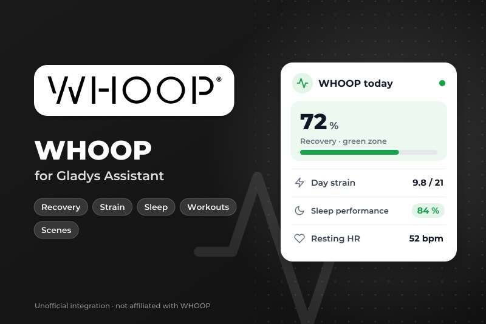
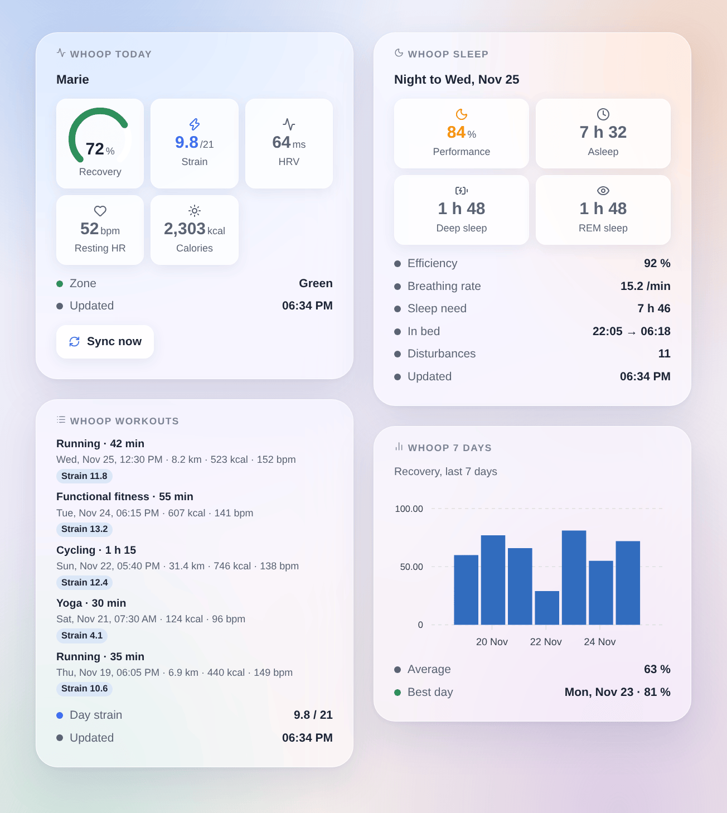
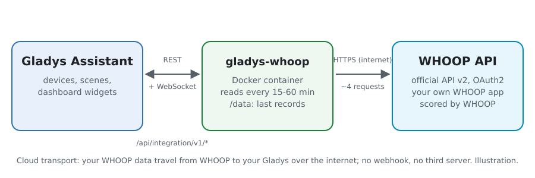
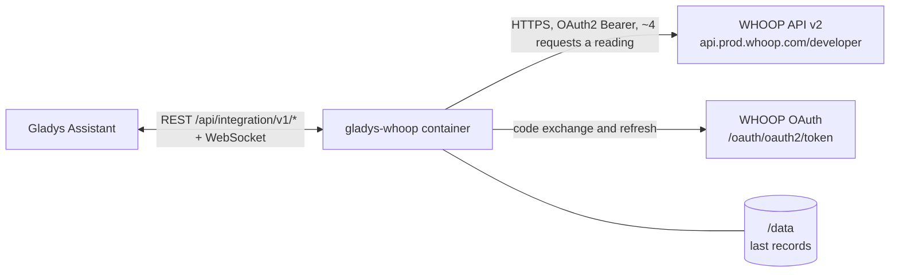
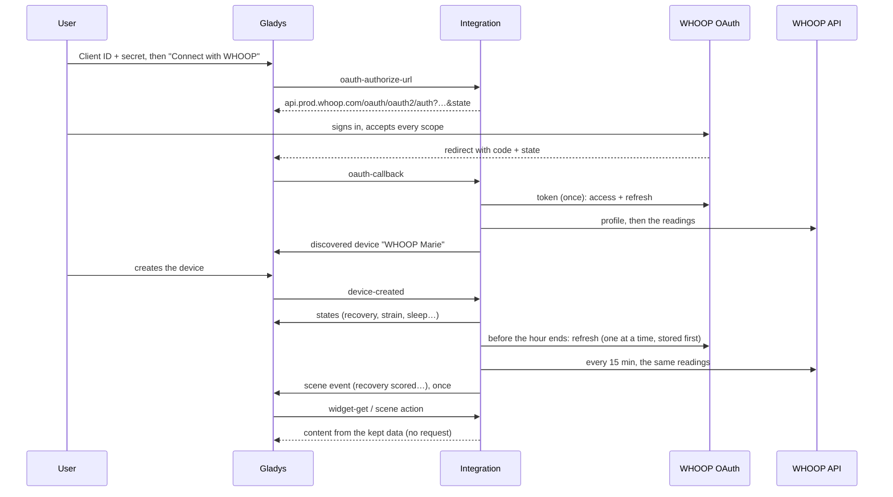

# Gladys WHOOP

**English** · [Français](README.fr.md) · [Deutsch](README.de.md) · [Español](README.es.md)

[](LICENSE)
[](https://github.com/William-De71/gladys-whoop/releases)
[](https://github.com/William-De71/gladys-whoop/actions/workflows/release.yml)
[](https://gladysassistant.com)



[Gladys Assistant](https://gladysassistant.com) external integration for **WHOOP**, through the official [WHOOP Developer Platform](https://developer.whoop.com) API and your own WHOOP app. Recovery, strain, sleep and workouts become a device, dashboard widgets and scene triggers: "when my recovery is scored, open the shutters and tell me how I slept".

User documentation: [English](docs/en.md) · [Français](docs/fr.md) · [Deutsch](docs/de.md) · [Español](docs/es.md).

> Community integration, not affiliated with, endorsed or sponsored by WHOOP, Inc. WHOOP is a trademark of WHOOP, Inc. Never tested with a real WHOOP account so far: every answer shape comes from the official API reference.

## Features

- **One device per linked member**: recovery and its zone, resting heart rate, HRV, blood oxygen, skin temperature; today's strain and calories; sleep performance, time asleep, efficiency and breathing rate; strain of the last workout.
- **Four widgets**: today (with a sync button), last sleep, workouts, last seven days.
- **Three scene triggers** and **one scene action** (see below).
- **OAuth 2.0 with your own WHOOP app**: the access token (about an hour) is renewed on its own; the refresh token rotates, so it is renewed one at a time and stored before it is used.
- **Cloud**, read every 15 to 60 minutes (about four requests), far below the limits (100 a minute, 10,000 a day per app), data kept in `/data`.
- English, French, German and Spanish everywhere.



## How it works





The user creates an app on developer-dashboard.whoop.com with the redirect URL of Gladys and every read scope. "Connect with WHOOP" opens WHOOP's sign-in with the scopes and `offline` (for a refresh token) and an 8-character `state` (as the docs ask); Gladys relays the code back, and the integration exchanges it once (credentials in the form body), then reads the basic profile for the member id. The access token lasts about an hour; before it ends (or after a 401) the refresh token is traded for a new pair. WHOOP rotates refresh tokens and refuses the second of two concurrent refreshes: one renewal runs at a time and the new pair is written to the configuration before any request uses it. Each reading asks the cycles, recoveries, sleeps and workouts (newest first), and the body measurement twice a day. WHOOP's webhooks are not used: they need a public HTTPS URL and signed requests whose header Gladys Plus does not relay.



### Transport

Cloud only (`"transports": ["cloud"]`): the catalog shows the cloud badge. Your WHOOP data travel from WHOOP's servers to your Gladys over the internet, with your own app; nothing goes through a third server. There is no local alternative, so there is no "prefer the local connection" button.

## Devices and features

| Feature                      | Category / type                  | Unit         |
| ---------------------------- | -------------------------------- | ------------ |
| Recovery                     | `level-sensor` / `decimal`       | %            |
| Recovery zone                | `text` / `text`                  | —            |
| Resting heart rate (bpm)     | `counter-sensor` / `integer`     | —            |
| Heart rate variability (HRV) | `duration` / `decimal`           | milliseconds |
| Blood oxygen (SpO2)          | `level-sensor` / `decimal`       | %            |
| Skin temperature             | `temperature-sensor` / `decimal` | °C           |
| Day strain (0-21)            | `level-sensor` / `decimal`       | —            |
| Calories today (kcal)        | `counter-sensor` / `integer`     | —            |
| Sleep performance            | `level-sensor` / `decimal`       | %            |
| Time asleep                  | `duration` / `decimal`           | hours        |
| Sleep efficiency             | `level-sensor` / `decimal`       | %            |
| Breathing rate (/min)        | `level-sensor` / `decimal`       | —            |
| Last workout strain (0-21)   | `level-sensor` / `decimal`       | —            |

Gladys has no health category and no heart rate, calorie or weight unit: counts use `counter-sensor` without unit (the unit is in the name), and the weight is only an output of the scene action. The device id comes from the WHOOP user id, never from a name. A value is only published once WHOOP has scored it.

## Scene triggers, actions and widgets

| Kind    | Key               | Use                                                             |
| ------- | ----------------- | --------------------------------------------------------------- |
| Trigger | `recovery_scored` | the morning recovery, with HRV, resting HR, SpO2 (filter: zone) |
| Trigger | `sleep_scored`    | a sleep or a nap, with its stages (filter: kind)                |
| Trigger | `workout_scored`  | a new workout, with its strain (filter: sport family)           |
| Action  | `get_summary`     | the latest values (19 outputs, weight included), no request     |
| Widget  | `today`           | recovery gauge in its zone color, strain, HRV, resting HR, sync |
| Widget  | `sleep`           | performance, time asleep, deep and REM sleep, sleep need        |
| Widget  | `workouts`        | the last workouts with their strain, today's strain             |
| Widget  | `week`            | recovery, strain, sleep performance or HRV of the last 7 days   |

Examples: **recovery scored** → send the summary to your phone and open the shutters; **recovery scored** in the red zone → softer morning lights; **workout scored** (running) → turn on the towel warmer.

## Requirements

- Gladys Assistant **5.3.0** or later (catalog keywords of Gladys 5.3, widgets and scenes of external integrations). Older instances cannot install the integration.
- An active WHOOP membership.
- A free WHOOP app created on [developer-dashboard.whoop.com](https://developer-dashboard.whoop.com), with every read scope and `https://my.gladysassistant.com/redirect/oauth` as redirect URL. The Sandbox tier of an app allows up to 10 members.

## Installation

- **From the store** of Gladys (Integrations → External integrations), in one click, once indexed.
- **From the repository URL**: `https://github.com/William-De71/gladys-whoop`.
- **Developer mode**: build the image locally (`docker build -t gladys-whoop .`) and install it from Gladys.

## Configuration

| Field                 | Description                                                                          |
| --------------------- | ------------------------------------------------------------------------------------ |
| Client ID             | The Client ID of your WHOOP app.                                                     |
| Client Secret         | Its secret (a secret field, never logged).                                           |
| Connect with WHOOP    | Links the account (read scopes and `offline`, read only).                            |
| Reading interval      | 15 (default), 30 or 60 minutes.                                                      |
| Language of the texts | Device names, recovery zone, sports and scene summaries (automatic: your dashboard). |

Buttons: **Sync now**, **Unlink the WHOOP account** (`DELETE /v2/user/access`, the tokens are forgotten) and **Diagnostic** (writes an anonymized state to the Logs tab).

## Usage

1. Create the WHOOP app, paste its Client ID and secret, save, click **Connect with WHOOP**.
2. In the **Discover** tab, create the "WHOOP …" device.
3. Add the widgets to a dashboard and build scenes on the triggers.

## Development

```bash
npm install
npm test                       # node --test, never touches the network
npm run lint && npm run format:check
npx github:GladysAssistant/integration-store . --skip-image-check
scripts/build-cover.sh         # cover.jpg from docs/assets/cover.svg
docs/illustrations/render.sh   # docs/assets/widgets.<lang>.png
node .github/scripts/release.mjs next
```

Locally, the SDK reads `GLADYS_HOST_API_URL`, `GLADYS_INTEGRATION_TOKEN` and `GLADYS_INTEGRATION_SELECTOR`; `TZ` sets "today". `DEBUG=gladys-integration-sdk` shows the SDK logs and checks every widget content. The tests use a fake WHOOP (rotating refresh tokens included) and made-up answers shaped like the API reference (`test/helpers/`). The rules of the project are in [CLAUDE.md](CLAUDE.md).

## Release process


Every merge on `main` runs the CI, then computes the version from the [Conventional Commits](https://www.conventionalcommits.org/) since the last tag: `feat` → minor, `fix` / `perf` → patch, `!` or `BREAKING CHANGE` → major (a minor below 1.0.0). `docs`, `chore`, `ci`, `test`, `style`, `refactor` and `build` alone publish nothing. The workflow then generates the changelog section, pushes the tag and builds the multi-architecture image. After that, `main` receives the release commit and the GitHub Release is created. A last job checks the public image, the store validator and the topic.

- The pull request title becomes the squash commit, then the changelog line: write it in English, for the user (`pr-title.yml` checks it). Never edit `CHANGELOG.md` by hand.
- 1.0.0 is a decision: Actions → Release → Run workflow with `release-as: 1.0.0`. `dry-run` shows the version and the notes without publishing.
- **Protected branch**: rulesets require a pull request on `main` and lock the `v*` tags; only the maintainer and deploy keys get through. The release pushes with the deploy key of the `release` environment (secret `RELEASE_DEPLOY_KEY`, `main` only): a run from another branch never gets it. `build.yml` and `github-release.yml` do not start on a tag: the release calls them, or run them by hand (Actions → Run workflow, with `version` for the image) to finish a release.
- After the first release, make the `ghcr.io` package public (Package settings → Change visibility), or Gladys cannot pull it.

## Troubleshooting

See [docs/en.md](docs/en.md#troubleshooting). Report issues with the versions of Gladys and of the integration, the strap model, and the lines of the **Diagnostic** button.

## Contributing

Issues and pull requests are welcome. Run `npm run format:check && npm run lint && npm test` before opening a pull request, and keep every external id and stored key unchanged (see [CLAUDE.md](CLAUDE.md)). A real answer of the WHOOP API that differs from the reference is very welcome as a new test case (remove names, e-mail addresses and ids first).

## Security

See [SECURITY.md](SECURITY.md): report vulnerabilities privately. The client secret is a secret field; the tokens and the OAuth state are internal configuration keys, never written to `/data` nor to the logs. An authorization code and a refresh token are never sent twice to WHOOP.

## Screenshots to come

The images above are illustrations, not screenshots. Real screenshots will go in `docs/assets/screenshots/` (PNG, 1280 × 800): `configuration.png`, `discovery.png`, `device.png`, `scene.png`.

## License

[Apache License 2.0](LICENSE) — see also [NOTICE](NOTICE). The data come from your WHOOP membership through the WHOOP Developer Platform API, under WHOOP's API terms. Thanks to the Gladys documentation and SDK.
