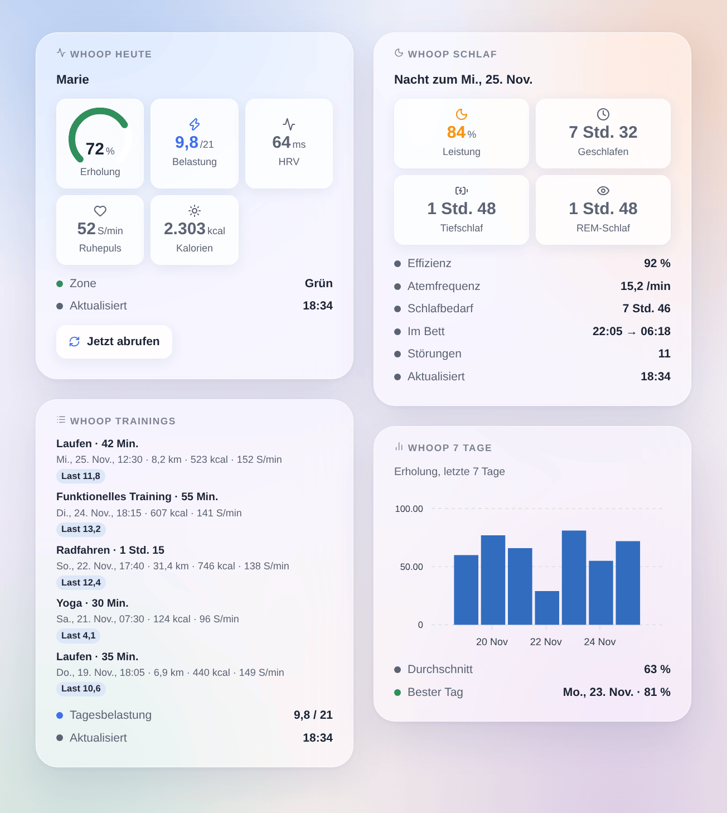

# WHOOP

## Überblick

Diese Integration bringt die Daten deiner **WHOOP**-Mitgliedschaft (Armband WHOOP 4.0 oder MG) über die **offizielle WHOOP Developer Platform API** in Gladys: Erholung, Belastung, Schlaf und Trainings, als Gerät, Widgets und Szenen.

- **Ein Gerät pro verknüpftem Mitglied** („WHOOP Marie“): Erholung und ihre Zone (grün, gelb, rot), Ruhepuls, Herzfrequenzvariabilität (HRV), Blutsauerstoff, Hauttemperatur; heutige Belastung und Kalorien; Leistung, Dauer und Effizienz des letzten Schlafs, Atemfrequenz; Belastung des letzten Trainings.
- **Widgets**: heute (mit einer Schaltfläche **Jetzt abrufen**), letzter Schlaf, letzte Trainings, letzte sieben Tage.
- **Szenen**: Erholung berechnet (du bist aufgewacht, die Morgenwerte sind da), Schlaf oder Nickerchen berechnet, Training berechnet; eine Aktion liest die letzten Werte (inklusive Gewicht) für eine Nachricht oder Bedingung.
- **Cloud**: Deine Daten gehen zwischen den Servern von WHOOP und deinem Gladys hin und her, mit **deiner eigenen WHOOP-App**; nichts läuft über einen Drittserver. WHOOP schickt Gladys keine Benachrichtigung: Die Integration fragt WHOOP alle **15 Minuten** ab (einstellbar) und wenn du **Jetzt abrufen** drückst.
- **Sobald WHOOP berechnet hat**: Ein Wert erscheint erst, wenn WHOOP ihn berechnet hat (nach der Synchronisierung des Armbands mit der App). Die Erholung kommt meist wenige Minuten nach dem Aufwachen.

Community-Integration, nicht mit WHOOP verbunden. Noch nicht mit einem echten WHOOP-Konto getestet: Sag uns, was du siehst. Das sind keine medizinischen Daten.



## Voraussetzungen

- Gladys **5.3.0** oder neuer.
- Eine aktive WHOOP-Mitgliedschaft und ihr Konto.
- Eine kostenlose **WHOOP-App**, einmalig auf dem Entwickler-Dashboard mit deinem WHOOP-Konto erstellt (etwa fünf Minuten). WHOOP bietet keinen gemeinsamen Schlüssel, und die Integration bringt keinen mit. Bis zu 10 Mitglieder können sich ohne Antrag bei WHOOP mit einer App verbinden.

## Konfiguration

### 1. Erstelle deine WHOOP-App

1. Öffne [developer-dashboard.whoop.com](https://developer-dashboard.whoop.com) und melde dich mit deinem **WHOOP**-Konto an.
2. Erstelle bei Bedarf ein Team, dann eine App: einen Namen („Gladys“), und hake **alle Lese-Berechtigungen** an (`read:recovery`, `read:cycles`, `read:sleep`, `read:workout`, `read:profile`, `read:body_measurement`).
3. Als **Redirect URL** gibst du genau ein:

   ```
   https://my.gladysassistant.com/redirect/oauth
   ```

   Das ist die HTTPS-Seite von Gladys, die deinen Browser zu deiner Instanz zurückschickt, egal unter welcher Adresse sie läuft. Wenn du Gladys per HTTPS erreichst und die erweiterte Option „Instanzadresse“ der Konfigurationsseite aktiviert hast, füge auch die dort angezeigte Adresse hinzu (WHOOP akzeptiert mehrere URLs; die gesendete muss genau einer davon entsprechen).

4. Speichere und kopiere dann **Client ID** und **Client Secret** der App.

### 2. In Gladys

1. Öffne die Integration **WHOOP**, füge **Client ID** und **Client Secret** ein und **speichere**.
2. Klicke auf **Mit WHOOP verbinden**, melde dich an und akzeptiere alle Berechtigungen. Du kommst verbunden zu Gladys zurück: Die Integration fragt WHOOP sofort ab.
3. Gehe zu **Entdecken** und füge das Gerät „WHOOP …“ hinzu, dann die Widgets zu einem Dashboard.
4. Die Verbindung erneuert sich selbst (das Zugriffstoken gilt etwa eine Stunde): Du musst dich nur erneut verbinden, wenn Gladys einen abgelehnten Zugriff meldet.

| Feld                | Standard    | Rolle                                                                |
| ------------------- | ----------- | -------------------------------------------------------------------- |
| Client ID           | —           | Die Client ID deiner WHOOP-App.                                      |
| Client Secret       | —           | Ihr Secret, nie angezeigt oder protokolliert.                        |
| Mit WHOOP verbinden | —           | Verknüpft dein WHOOP-Konto (nur Lesen, dazu `offline` zum Erneuern). |
| Abfrageintervall    | 15 Min.     | 15, 30 oder 60 Minuten; jede Abfrage kostet etwa vier Anfragen.      |
| Sprache der Texte   | Automatisch | Geräte- und Funktionsnamen, Zone, Sportarten, Szenentexte.           |

Schaltflächen: **Jetzt abrufen** (nicht zweimal innerhalb von zwei Minuten), **WHOOP-Konto trennen** (widerruft den Zugriff deiner App und vergisst die Tokens; das Gerät bleibt) und **Diagnose** (schreibt eine anonymisierte Zusammenfassung in den Reiter Protokolle).

## Verwendung

### Gerät

| Funktion                        | Einheit / Skala                   | Aktualisiert                  |
| ------------------------------- | --------------------------------- | ----------------------------- |
| Erholung                        | %                                 | beim Aufwachen                |
| Erholungszone                   | grün 67-100, gelb 34-66, rot 0-33 | beim Aufwachen                |
| Ruhepuls                        | S/min                             | beim Aufwachen                |
| Herzfrequenzvariabilität (HRV)  | ms (RMSSD)                        | beim Aufwachen                |
| Blutsauerstoff (SpO2)           | %                                 | beim Aufwachen (ab WHOOP 4.0) |
| Hauttemperatur                  | °C                                | beim Aufwachen (ab WHOOP 4.0) |
| Tagesbelastung                  | 0 bis 21                          | den ganzen Tag                |
| Kalorien heute                  | kcal                              | den ganzen Tag                |
| Schlafleistung                  | %                                 | beim Aufwachen                |
| Schlafdauer                     | Stunden                           | beim Aufwachen                |
| Schlafeffizienz                 | %                                 | beim Aufwachen                |
| Atemfrequenz                    | Atemzüge pro Minute               | beim Aufwachen                |
| Belastung des letzten Trainings | 0 bis 21                          | nach einem Training           |

Ein WHOOP-„Tag“ reicht von einem Aufwachen zum nächsten. Eine Funktion behält ihren letzten Wert, bis WHOOP den nächsten berechnet hat. Gladys hat keine Gewichtseinheit: Das Gewicht liefert nur die Szenenaktion.

### Szenen

| Auslöser           | Wann                                                 | Filter             |
| ------------------ | ---------------------------------------------------- | ------------------ |
| Erholung berechnet | WHOOP hat die Morgen-Erholung berechnet              | Mitglied, Zone     |
| Schlaf berechnet   | WHOOP hat einen Schlaf oder ein Nickerchen berechnet | Mitglied, Art      |
| Training berechnet | WHOOP hat ein neues Training berechnet               | Mitglied, Sportart |

Jedes Ereignis trägt seine Werte (`{{triggerEvent.data.recovery}}`, `zone`, `hrv`, `sleep_hours`, `strain` …) und eine fertige `summary`. Für Daten, die beim Start der Integration schon da sind, oder für Daten älter als zwei Tage wird nichts ausgelöst. Die Aktion **WHOOP: letzte Daten lesen** liefert Erholung, Belastung, Schlaf, letztes Training und Gewicht der letzten Abfrage.

Beispiele:

- **Erholung berechnet** → „{{triggerEvent.data.summary}}“ an dein Handy senden und die Rollläden im Schlafzimmer öffnen.
- **Erholung berechnet**, Zone rot → das Morgenlicht dämpfen und die Trainingserinnerung verschieben.
- **Training berechnet**, Sportart „Laufen“ → den Handtuchheizkörper im Bad einschalten.

## Fehlerbehebung

- **WHOOP zeigt nach dem Verbinden einen Redirect-Fehler**: Die Redirect URL der App ist nicht identisch mit der von Gladys gesendeten. Prüfe `https://my.gladysassistant.com/redirect/oauth` (ohne abschließenden Schrägstrich) auf dem Entwickler-Dashboard. Der Reiter Protokolle zeigt die verwendete Redirect-URI.
- **„Die Verbindung zu WHOOP ist fehlgeschlagen (invalid_client)“**: Client ID oder Client Secret falsch. Kopiere sie erneut und speichere vor dem Verbinden.
- **„WHOOP hat kein Refresh-Token geliefert“**: Die Berechtigung `offline` wurde verweigert. Verbinde dich erneut und akzeptiere alle Berechtigungen.
- **„WHOOP hat eine Berechtigung verweigert“** (HTTP 403): Der App fehlt eine Lese-Berechtigung oder sie wurde verweigert. Hake auf dem Dashboard alle an und verbinde dich erneut.
- **„WHOOP hat die Verbindung abgelehnt“**: Der Zugriff wurde widerrufen (in der WHOOP-App, durch **Trennen**) oder das Refresh-Token ist nicht mehr gültig. Klicke erneut auf **Mit WHOOP verbinden**.
- **Mehr als 10 Mitglieder**: Die Sandbox-Stufe einer App endet bei 10 Mitgliedern; beantrage auf dem Dashboard eine höhere Stufe.
- **Ein Problem melden**: [GitHub-Issues](https://github.com/William-De71/gladys-whoop/issues) mit den Versionen von Gladys und der Integration, dem Armbandmodell und den Zeilen der Schaltfläche **Diagnose** (ohne Token und Namen).

Warum keine sofortige Benachrichtigung? Die Webhooks von WHOOP brauchen eine öffentliche HTTPS-Adresse und signierte Anfragen, deren Header Gladys Plus nicht weitergibt: Die Integration fragt WHOOP deshalb in ihrem eigenen Takt ab.
