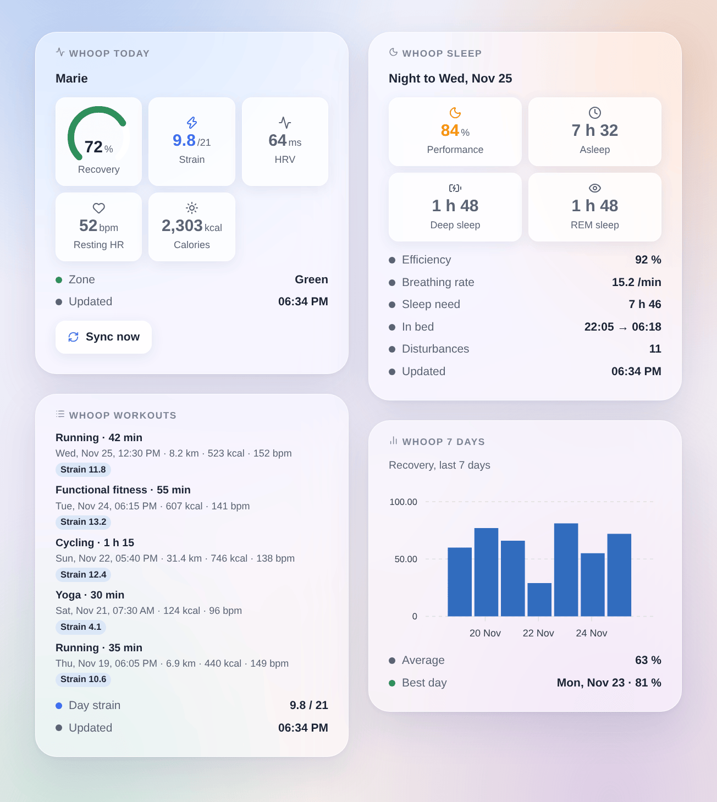

# WHOOP

## Overview

This integration brings the data of your **WHOOP** membership (WHOOP 4.0 or MG strap) into Gladys, through the **official WHOOP Developer Platform API**: recovery, strain, sleep and workouts, as a device, widgets and scenes.

- **One device per linked member** ("WHOOP Marie"): recovery and its zone (green, yellow, red), resting heart rate, heart rate variability (HRV), blood oxygen, skin temperature; today's strain and calories; performance, duration and efficiency of the last sleep, breathing rate; strain of the last workout.
- **Widgets**: today (with a **Sync now** button), last sleep, last workouts, last seven days.
- **Scenes**: recovery scored (you woke up, the morning numbers are there), sleep or nap scored, workout scored; an action reads the latest values (weight included) for a message or a condition.
- **Cloud**: your data travel between the servers of WHOOP and your Gladys, with **your own WHOOP app**; nothing goes through a third-party server. WHOOP sends no notification to Gladys: the integration reads WHOOP every **15 minutes** (adjustable) and when you press **Sync now**.
- **Once WHOOP has scored it**: a value only shows once WHOOP has scored it (after the strap synced with the app). The recovery usually comes a few minutes after waking up.

Community integration, not affiliated with WHOOP. Not yet tested with a real WHOOP account: tell us what you see. These are not medical data.



## Requirements

- Gladys **5.3.0** or newer.
- An active WHOOP membership and its account.
- A free **WHOOP app**, created once on the developer dashboard with your WHOOP account (about five minutes). WHOOP offers no shared key and the integration ships none. Up to 10 members can connect to an app without asking WHOOP anything.

## Configuration

### 1. Create your WHOOP app

1. Open [developer-dashboard.whoop.com](https://developer-dashboard.whoop.com) and sign in with your **WHOOP** account.
2. Create a team if asked, then an app: a name ("Gladys"), and tick **every read scope** (`read:recovery`, `read:cycles`, `read:sleep`, `read:workout`, `read:profile`, `read:body_measurement`).
3. As **Redirect URL**, enter exactly:

   ```
   https://my.gladysassistant.com/redirect/oauth
   ```

   This is the HTTPS page of Gladys that sends your browser back to your instance, whatever its address. If you reach Gladys over HTTPS and enabled the advanced "instance address" option of the configuration screen, also add the address that screen shows (WHOOP accepts several URLs; the one sent must be identical to one of them).

4. Save, then copy the **Client ID** and the **Client Secret** of the app.

### 2. In Gladys

1. Open the **WHOOP** integration, paste the **Client ID** and the **Client Secret**, then **save**.
2. Click **Connect with WHOOP**, sign in and accept every permission. You come back to Gladys, connected: the integration reads WHOOP right away.
3. Go to **Discover** and add the "WHOOP …" device, then add the widgets to a dashboard.
4. The connection renews itself (the access token lasts about an hour): you only need to connect again if Gladys reports a refused access.

| Field              | Default   | Role                                                           |
| ------------------ | --------- | -------------------------------------------------------------- |
| Client ID          | —         | The Client ID of your WHOOP app.                               |
| Client Secret      | —         | Its secret, never shown nor written to the logs.               |
| Connect with WHOOP | —         | Links your WHOOP account (read only, plus `offline` to renew). |
| Reading interval   | 15 min    | 15, 30 or 60 minutes; each reading costs about four requests.  |
| Language of texts  | Automatic | Device and feature names, zone, sports, scene texts.           |

Buttons: **Sync now** (not twice within two minutes), **Unlink the WHOOP account** (revokes the access of your app and forgets the tokens; the device stays) and **Diagnostic** (writes an anonymized summary to the Logs tab).

## Usage

### Device

| Feature                | Unit / scale                         | Updated                         |
| ---------------------- | ------------------------------------ | ------------------------------- |
| Recovery               | %                                    | on waking                       |
| Recovery zone          | green 67-100, yellow 34-66, red 0-33 | on waking                       |
| Resting heart rate     | bpm                                  | on waking                       |
| Heart rate variability | ms (RMSSD)                           | on waking                       |
| Blood oxygen (SpO2)    | %                                    | on waking (WHOOP 4.0 and later) |
| Skin temperature       | °C                                   | on waking (WHOOP 4.0 and later) |
| Day strain             | 0 to 21                              | all day                         |
| Calories today         | kcal                                 | all day                         |
| Sleep performance      | %                                    | on waking                       |
| Time asleep            | hours                                | on waking                       |
| Sleep efficiency       | %                                    | on waking                       |
| Breathing rate         | breaths per minute                   | on waking                       |
| Last workout strain    | 0 to 21                              | after a workout                 |

A WHOOP "day" runs from one wake-up to the next. A feature keeps its last value until WHOOP has scored the next one. Gladys has no weight unit: the weight is only given by the scene action.

### Scenes

| Trigger         | When                              | Filters       |
| --------------- | --------------------------------- | ------------- |
| Recovery scored | WHOOP scored the morning recovery | member, zone  |
| Sleep scored    | WHOOP scored a sleep or a nap     | member, kind  |
| Workout scored  | WHOOP scored a new workout        | member, sport |

Each event carries its values (`{{triggerEvent.data.recovery}}`, `zone`, `hrv`, `sleep_hours`, `strain`…) and a ready-made `summary`. Nothing fires for the data already there when the integration starts, nor for data older than two days. The action **WHOOP: read the latest data** gives the recovery, strain, sleep, last workout and weight of the last reading.

Examples:

- **Recovery scored** → send "{{triggerEvent.data.summary}}" to your phone, and open the bedroom shutters.
- **Recovery scored**, zone red → soften the morning lights and postpone the training reminder.
- **Workout scored**, sport "Running" → turn on the bathroom towel heater.

## Troubleshooting

- **WHOOP shows a redirect error after Connect**: the Redirect URL of the app is not identical to the one Gladys sends. Check `https://my.gladysassistant.com/redirect/oauth` (no trailing slash) on the developer dashboard. The Logs tab shows the redirect URI used.
- **"The connection to WHOOP failed (invalid_client)"**: wrong Client ID or Client Secret. Copy them again and save before connecting.
- **"WHOOP gave no refresh token"**: the `offline` permission was refused. Connect again and accept every permission.
- **"WHOOP refused a permission"** (HTTP 403): a read scope is missing from the app or was refused. Tick them all on the dashboard, then connect again.
- **"WHOOP refused the connection"**: the access was revoked (in the WHOOP app, by **Unlink**) or the refresh token is no longer valid. Click **Connect with WHOOP** again.
- **More than 10 members**: the Sandbox tier of an app stops at 10 members; ask for a higher tier on the dashboard.
- **Report a problem**: [GitHub issues](https://github.com/William-De71/gladys-whoop/issues) with the versions of Gladys and of the integration, the strap model and the lines of the **Diagnostic** button (no token, no name).

Why no instant notification? WHOOP's webhooks need a public HTTPS address and signed requests whose header Gladys Plus does not relay: the integration reads WHOOP at its own pace.
