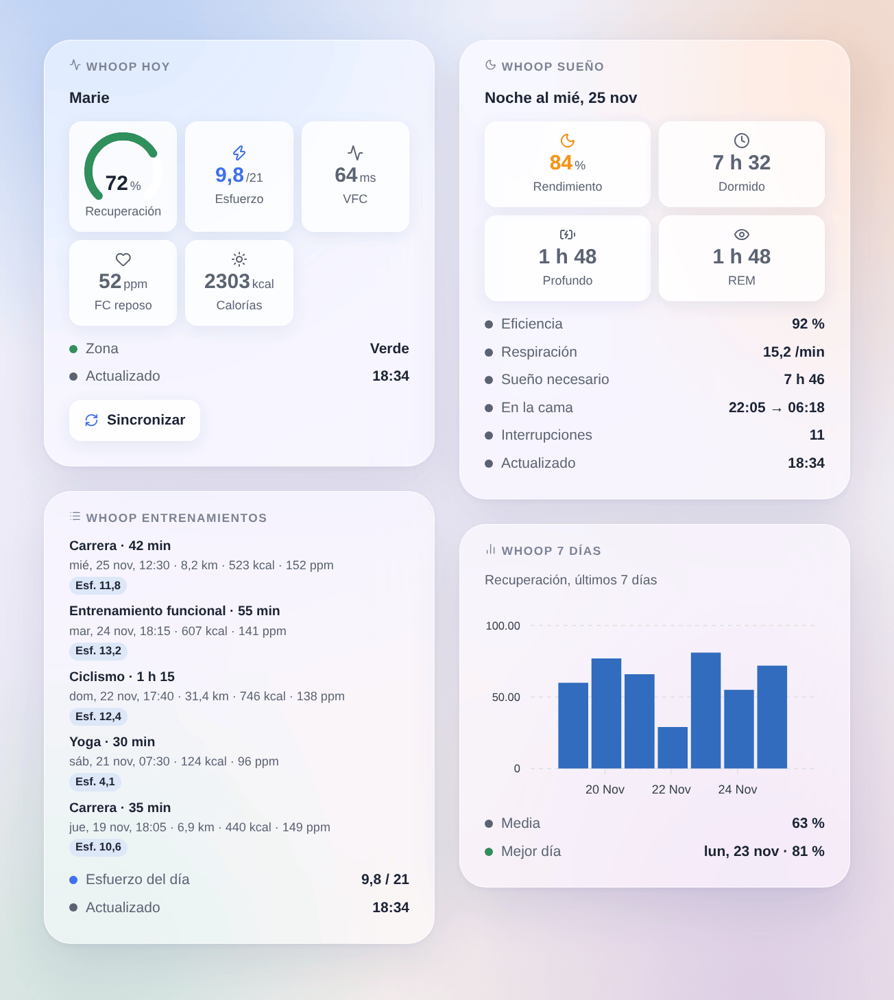

# WHOOP

## Presentación

Esta integración lleva a Gladys los datos de su suscripción **WHOOP** (pulsera WHOOP 4.0 o MG), mediante la **API oficial WHOOP Developer Platform**: recuperación, esfuerzo, sueño y entrenamientos, como dispositivo, widgets y escenas.

- **Un dispositivo por miembro vinculado** («WHOOP Marie»): recuperación y su zona (verde, amarillo, rojo), frecuencia cardíaca en reposo, variabilidad cardíaca (VFC), oxígeno en sangre, temperatura de la piel; esfuerzo y calorías del día; rendimiento, duración y eficiencia del último sueño, frecuencia respiratoria; esfuerzo del último entrenamiento.
- **Widgets**: hoy (con un botón **Sincronizar**), último sueño, últimos entrenamientos, últimos siete días.
- **Escenas**: recuperación calculada (se ha despertado, los datos de la mañana están listos), sueño o siesta calculados, entrenamiento calculado; una acción lee los últimos valores (peso incluido) para un mensaje o una condición.
- **Nube**: sus datos viajan entre los servidores de WHOOP y su Gladys, con **su propia aplicación WHOOP**; nada pasa por un servidor de terceros. WHOOP no envía ninguna notificación a Gladys: la integración lee WHOOP cada **15 minutos** (ajustable) y cuando pulsa **Sincronizar**.
- **Una vez calculado por WHOOP**: un valor solo aparece cuando WHOOP lo ha calculado (tras sincronizar la pulsera con la aplicación). La recuperación suele llegar unos minutos después de despertarse.

Integración comunitaria, sin relación con WHOOP. Todavía no probada con una cuenta WHOOP real: cuéntenos lo que ve. No son datos médicos.



## Requisitos

- Gladys **5.3.0** o más reciente.
- Una suscripción WHOOP activa y su cuenta.
- Una **aplicación WHOOP** gratuita, creada una vez en el panel de desarrollador con su cuenta WHOOP (unos cinco minutos). WHOOP no ofrece una clave compartida y la integración no incluye ninguna. Hasta 10 miembros pueden conectarse a una aplicación sin pedir nada a WHOOP.

## Configuración

### 1. Cree su aplicación WHOOP

1. Abra [developer-dashboard.whoop.com](https://developer-dashboard.whoop.com) e inicie sesión con su cuenta **WHOOP**.
2. Cree un equipo (Team) si se lo pide y luego una aplicación: un nombre («Gladys»), y marque **todos los permisos de lectura** (`read:recovery`, `read:cycles`, `read:sleep`, `read:workout`, `read:profile`, `read:body_measurement`).
3. Como **Redirect URL**, introduzca exactamente:

   ```
   https://my.gladysassistant.com/redirect/oauth
   ```

   Es la página HTTPS de Gladys que devuelve su navegador a su instancia, sea cual sea su dirección. Si accede a Gladys por HTTPS y activó la opción avanzada «dirección de la instancia» de la pantalla de configuración, añada también la dirección que muestra esa pantalla (WHOOP acepta varias URL; la enviada debe ser idéntica a una de ellas).

4. Guarde y copie el **Client ID** y el **Client Secret** de la aplicación.

### 2. En Gladys

1. Abra la integración **WHOOP**, pegue el **Client ID** y el **Client Secret** y **guarde**.
2. Pulse **Conectar con WHOOP**, inicie sesión y acepte todos los permisos. Vuelve a Gladys, conectado: la integración lee WHOOP de inmediato.
3. Vaya a **Descubrir** y añada el dispositivo «WHOOP …», luego añada los widgets a un panel.
4. La conexión se renueva sola (el token de acceso dura una hora aproximadamente): solo tiene que volver a conectarse si Gladys indica un acceso rechazado.

| Campo                | Por defecto | Función                                                                        |
| -------------------- | ----------- | ------------------------------------------------------------------------------ |
| Client ID            | —           | El Client ID de su aplicación WHOOP.                                           |
| Client Secret        | —           | Su secreto, nunca mostrado ni escrito en los registros.                        |
| Conectar con WHOOP   | —           | Vincula su cuenta WHOOP (solo lectura, más `offline` para renovar).            |
| Intervalo de lectura | 15 min      | 15, 30 o 60 minutos; cada lectura cuesta unas cuatro solicitudes.              |
| Idioma de los textos | Automático  | Nombres del dispositivo y de las funciones, zona, deportes, textos de escenas. |

Botones: **Sincronizar ahora** (no dos veces en dos minutos), **Desvincular la cuenta WHOOP** (revoca el acceso de su aplicación y olvida los tokens; el dispositivo se queda) y **Diagnóstico** (escribe un resumen anonimizado en la pestaña Registros).

## Uso

### Dispositivo

| Función                           | Unidad / escala                         | Actualización                          |
| --------------------------------- | --------------------------------------- | -------------------------------------- |
| Recuperación                      | %                                       | al despertar                           |
| Zona de recuperación              | verde 67-100, amarillo 34-66, rojo 0-33 | al despertar                           |
| Frecuencia cardíaca en reposo     | ppm                                     | al despertar                           |
| Variabilidad cardíaca (VFC)       | ms (RMSSD)                              | al despertar                           |
| Oxígeno en sangre (SpO2)          | %                                       | al despertar (WHOOP 4.0 y posteriores) |
| Temperatura de la piel            | °C                                      | al despertar (WHOOP 4.0 y posteriores) |
| Esfuerzo del día                  | 0 a 21                                  | todo el día                            |
| Calorías de hoy                   | kcal                                    | todo el día                            |
| Rendimiento del sueño             | %                                       | al despertar                           |
| Tiempo dormido                    | horas                                   | al despertar                           |
| Eficiencia del sueño              | %                                       | al despertar                           |
| Frecuencia respiratoria           | respiraciones por minuto                | al despertar                           |
| Esfuerzo del último entrenamiento | 0 a 21                                  | tras un entrenamiento                  |

Un «día» WHOOP va de un despertar al siguiente. Una función conserva su último valor hasta que WHOOP calcula el siguiente. Gladys no tiene unidad de peso: el peso solo lo da la acción de escena.

### Escenas

| Disparador              | Cuándo                                     | Filtros          |
| ----------------------- | ------------------------------------------ | ---------------- |
| Recuperación calculada  | WHOOP calculó la recuperación de la mañana | miembro, zona    |
| Sueño calculado         | WHOOP calculó un sueño o una siesta        | miembro, tipo    |
| Entrenamiento calculado | WHOOP calculó un nuevo entrenamiento       | miembro, deporte |

Cada evento lleva sus valores (`{{triggerEvent.data.recovery}}`, `zone`, `hrv`, `sleep_hours`, `strain`…) y un `summary` ya redactado. No se dispara nada por los datos ya presentes al arrancar la integración, ni por los de más de dos días. La acción **WHOOP: leer los últimos datos** da la recuperación, el esfuerzo, el sueño, el último entrenamiento y el peso de la última lectura.

Ejemplos:

- **Recuperación calculada** → enviar «{{triggerEvent.data.summary}}» a su teléfono y abrir las persianas del dormitorio.
- **Recuperación calculada**, zona roja → suavizar las luces de la mañana y aplazar el recordatorio de entrenamiento.
- **Entrenamiento calculado**, deporte «Carrera» → encender el toallero del baño.

## Solución de problemas

- **WHOOP muestra un error de redirección tras Conectar**: la Redirect URL de la aplicación no es idéntica a la que envía Gladys. Compruebe `https://my.gladysassistant.com/redirect/oauth` (sin barra final) en el panel de desarrollador. La pestaña Registros muestra la URI de redirección utilizada.
- **«La conexión con WHOOP ha fallado (invalid_client)»**: Client ID o Client Secret erróneos. Vuelva a copiarlos y guarde antes de conectarse.
- **«WHOOP no ha dado token de renovación»**: se rechazó el permiso `offline`. Vuelva a conectarse aceptando todos los permisos.
- **«WHOOP ha rechazado un permiso»** (HTTP 403): a la aplicación le falta un permiso de lectura o se rechazó. Márquelos todos en el panel y vuelva a conectarse.
- **«WHOOP ha rechazado la conexión»**: el acceso se revocó (en la aplicación WHOOP, con **Desvincular**) o el token de renovación ya no es válido. Pulse de nuevo **Conectar con WHOOP**.
- **Más de 10 miembros**: el nivel Sandbox de una aplicación se limita a 10 miembros; pida un nivel superior en el panel.
- **Informar de un problema**: [issues de GitHub](https://github.com/William-De71/gladys-whoop/issues) con las versiones de Gladys y de la integración, el modelo de pulsera y las líneas del botón **Diagnóstico** (sin token ni nombre).

¿Por qué no hay notificación instantánea? Los webhooks de WHOOP exigen una dirección HTTPS pública y solicitudes firmadas cuya cabecera Gladys Plus no transmite: la integración lee WHOOP a su propio ritmo.
