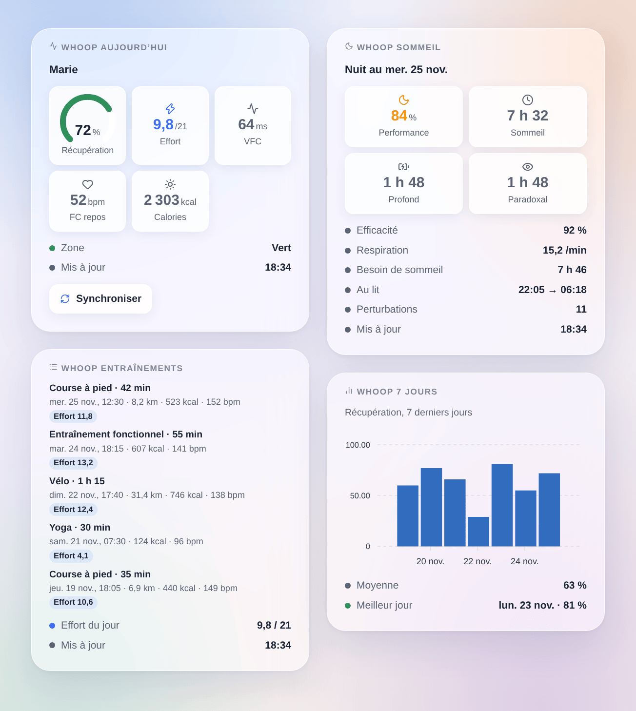

# WHOOP

## Présentation

Cette intégration amène dans Gladys les données de votre abonnement **WHOOP** (bracelet WHOOP 4.0 ou MG), par l’**API officielle WHOOP Developer Platform** : récupération, effort, sommeil et entraînements, sous forme d’appareil, de widgets et de scènes.

- **Un appareil par membre lié** (« WHOOP Marie ») : récupération et sa zone (vert, jaune, rouge), fréquence cardiaque au repos, variabilité cardiaque (VFC), oxygène sanguin, température cutanée ; effort et calories du jour ; performance, durée et efficacité du dernier sommeil, fréquence respiratoire ; effort du dernier entraînement.
- **Widgets** : aujourd’hui (avec un bouton **Synchroniser**), dernier sommeil, derniers entraînements, sept derniers jours.
- **Scènes** : récupération calculée (vous êtes réveillé, les chiffres du matin sont là), sommeil ou sieste calculés, entraînement calculé ; une action lit les dernières valeurs (poids compris) pour un message ou une condition.
- **Cloud** : vos données transitent entre les serveurs de WHOOP et votre Gladys, avec **votre propre application WHOOP** ; rien ne passe par un serveur tiers. WHOOP n’envoie aucune notification à Gladys : l’intégration lit WHOOP toutes les **15 minutes** (réglable) et quand vous appuyez sur **Synchroniser**.
- **Après le calcul de WHOOP** : une valeur n’apparaît qu’une fois calculée par WHOOP (après la synchro du bracelet avec l’application). La récupération arrive en général quelques minutes après le réveil.

Intégration communautaire, sans lien avec WHOOP. Pas encore testée avec un vrai compte WHOOP : dites-nous ce que vous voyez. Ce ne sont pas des données médicales.



## Prérequis

- Gladys **5.3.0** ou plus récent.
- Un abonnement WHOOP actif et son compte.
- Une **application WHOOP** gratuite, créée une fois sur le tableau de bord développeur avec votre compte WHOOP (environ cinq minutes). WHOOP ne propose pas de clé partagée et l’intégration n’en embarque aucune. Jusqu’à 10 membres peuvent se connecter à une application sans rien demander à WHOOP.

## Configuration

### 1. Créez votre application WHOOP

1. Ouvrez [developer-dashboard.whoop.com](https://developer-dashboard.whoop.com) et connectez-vous avec votre compte **WHOOP**.
2. Créez une équipe (Team) si c’est demandé, puis une application : un nom (« Gladys »), et cochez **toutes les autorisations de lecture** (`read:recovery`, `read:cycles`, `read:sleep`, `read:workout`, `read:profile`, `read:body_measurement`).
3. Comme **Redirect URL**, saisissez exactement :

   ```
   https://my.gladysassistant.com/redirect/oauth
   ```

   C’est la page HTTPS de Gladys qui renvoie votre navigateur vers votre instance, quelle que soit son adresse. Si vous accédez à Gladys en HTTPS et avez activé l’option avancée « adresse de l’instance » de l’écran de configuration, ajoutez aussi l’adresse affichée par cet écran (WHOOP accepte plusieurs URL ; celle envoyée doit être identique à l’une d’elles).

4. Enregistrez, puis copiez le **Client ID** et le **Client Secret** de l’application.

### 2. Dans Gladys

1. Ouvrez l’intégration **WHOOP**, collez le **Client ID** et le **Client Secret**, puis **enregistrez**.
2. Cliquez sur **Se connecter avec WHOOP**, connectez-vous et acceptez toutes les autorisations. Vous revenez dans Gladys, connecté : l’intégration lit WHOOP tout de suite.
3. Allez dans **Découverte** et ajoutez l’appareil « WHOOP … », puis ajoutez les widgets à un tableau de bord.
4. La connexion se renouvelle seule (le jeton d’accès dure environ une heure) : vous n’avez à vous reconnecter que si Gladys signale un accès refusé.

| Champ                   | Par défaut  | Rôle                                                                        |
| ----------------------- | ----------- | --------------------------------------------------------------------------- |
| Client ID               | —           | Le Client ID de votre application WHOOP.                                    |
| Client Secret           | —           | Son secret, jamais affiché ni écrit dans les journaux.                      |
| Se connecter avec WHOOP | —           | Lie votre compte WHOOP (lecture seule, plus `offline` pour renouveler).     |
| Fréquence de lecture    | 15 min      | 15, 30 ou 60 minutes ; chaque lecture coûte environ quatre requêtes.        |
| Langue des textes       | Automatique | Noms de l’appareil et des fonctionnalités, zone, sports, textes des scènes. |

Boutons : **Synchroniser maintenant** (pas deux fois en deux minutes), **Délier le compte WHOOP** (révoque l’accès de votre application et oublie les jetons ; l’appareil reste) et **Diagnostic** (écrit un résumé anonymisé dans l’onglet Journaux).

## Utilisation

### Appareil

| Fonctionnalité                 | Unité / échelle                      | Mise à jour                    |
| ------------------------------ | ------------------------------------ | ------------------------------ |
| Récupération                   | %                                    | au réveil                      |
| Zone de récupération           | vert 67-100, jaune 34-66, rouge 0-33 | au réveil                      |
| Fréquence cardiaque au repos   | bpm                                  | au réveil                      |
| Variabilité cardiaque (VFC)    | ms (RMSSD)                           | au réveil                      |
| Oxygène sanguin (SpO2)         | %                                    | au réveil (WHOOP 4.0 et après) |
| Température cutanée            | °C                                   | au réveil (WHOOP 4.0 et après) |
| Effort du jour                 | 0 à 21                               | toute la journée               |
| Calories du jour               | kcal                                 | toute la journée               |
| Performance du sommeil         | %                                    | au réveil                      |
| Temps de sommeil               | heures                               | au réveil                      |
| Efficacité du sommeil          | %                                    | au réveil                      |
| Fréquence respiratoire         | respirations par minute              | au réveil                      |
| Effort du dernier entraînement | 0 à 21                               | après un entraînement          |

Le « jour » WHOOP va d’un réveil au suivant. Une fonctionnalité garde sa dernière valeur tant que WHOOP n’a pas calculé la suivante. Gladys n’a pas d’unité de poids : le poids n’est donné que par l’action de scène.

### Scènes

| Déclencheur           | Quand                                    | Filtres       |
| --------------------- | ---------------------------------------- | ------------- |
| Récupération calculée | WHOOP a calculé la récupération du matin | membre, zone  |
| Sommeil calculé       | WHOOP a calculé un sommeil ou une sieste | membre, type  |
| Entraînement calculé  | WHOOP a calculé un nouvel entraînement   | membre, sport |

Chaque événement porte ses valeurs (`{{triggerEvent.data.recovery}}`, `zone`, `hrv`, `sleep_hours`, `strain`…) et un `summary` tout fait. Rien ne se déclenche pour les données déjà présentes au démarrage de l’intégration, ni pour celles de plus de deux jours. L’action **WHOOP : lire les dernières données** donne la récupération, l’effort, le sommeil, le dernier entraînement et le poids de la dernière lecture.

Exemples :

- **Récupération calculée** → envoyer « {{triggerEvent.data.summary}} » sur votre téléphone, et ouvrir les volets de la chambre.
- **Récupération calculée**, zone rouge → adoucir les lumières du matin et repousser le rappel d’entraînement.
- **Entraînement calculé**, sport « Course à pied » → allumer le sèche-serviettes de la salle de bain.

## Dépannage

- **WHOOP affiche une erreur de redirection après Se connecter** : la Redirect URL de l’application n’est pas identique à celle envoyée par Gladys. Vérifiez `https://my.gladysassistant.com/redirect/oauth` (sans barre finale) sur le tableau de bord développeur. L’onglet Journaux affiche l’URI de redirection utilisée.
- **« La connexion à WHOOP a échoué (invalid_client) »** : Client ID ou Client Secret erroné. Recopiez-les et enregistrez avant de vous connecter.
- **« WHOOP n’a pas donné de jeton de renouvellement »** : l’autorisation `offline` a été refusée. Reconnectez-vous en acceptant toutes les autorisations.
- **« WHOOP a refusé une autorisation »** (HTTP 403) : une autorisation de lecture manque à l’application ou a été refusée. Cochez-les toutes sur le tableau de bord, puis reconnectez-vous.
- **« WHOOP a refusé la connexion »** : l’accès a été révoqué (dans l’application WHOOP, par **Délier**) ou le jeton de renouvellement n’est plus valable. Cliquez à nouveau sur **Se connecter avec WHOOP**.
- **Plus de 10 membres** : l’offre Sandbox d’une application s’arrête à 10 membres ; demandez un palier supérieur sur le tableau de bord.
- **Signaler un problème** : [issues GitHub](https://github.com/William-De71/gladys-whoop/issues) avec les versions de Gladys et de l’intégration, le modèle de bracelet et les lignes du bouton **Diagnostic** (sans jeton ni nom).

Pourquoi pas de notification instantanée ? Les webhooks de WHOOP exigent une adresse HTTPS publique et des requêtes signées dont Gladys Plus ne transmet pas l’en-tête : l’intégration lit donc WHOOP à son propre rythme.
